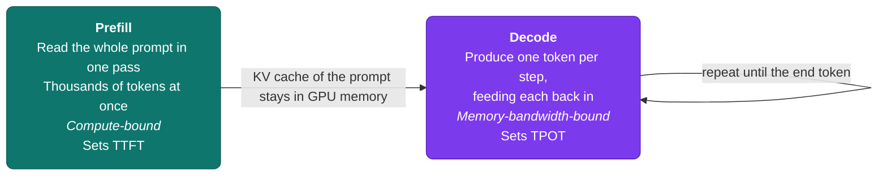
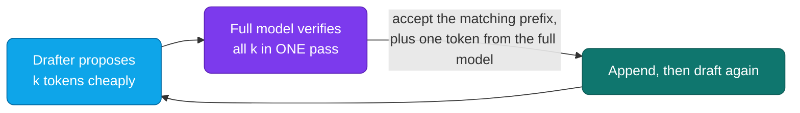

# Lesson 06: LLM Serving Optimization

[Lesson 02](./02-vllm-deployment.md) got a model serving behind an API, and [Lesson 05](./05-llm-fine-tuning-infrastructure.md) produced a model worth serving. This lesson is about making that deployment cheaper and faster without changing what the model says. The weights stay the same, or very nearly. What changes is how many useful tokens each GPU-hour produces, and how long each user waits for them.

The lesson has three parts. First, **what serving optimization is all about**: what it can and can't fix, and the few numbers you measure it with. Second, **the core logic**: why generating text is limited by memory instead of compute, and how that one fact explains quantization, batching, caching, and speculative decoding. Third, a **step-by-step guide** that takes a baseline deployment through measurement, quantization, scheduling, caching, speculative decoding, and multi-GPU scaling, ending with a cost per million tokens you can defend.

**Prerequisites:** [Lesson 01](./01-introduction-llm-infrastructure.md), [Lesson 02: vLLM Deployment](./02-vllm-deployment.md) (PagedAttention and continuous batching are introduced there, and this lesson builds on them), [Lesson 05](./05-llm-fine-tuning-infrastructure.md#core-logic-of-fine-tuning) (the memory arithmetic and the 4-bit quantization of QLoRA).

### Contents

1. [Introduction: What Serving Optimization Is All About](#introduction-what-serving-optimization-is-all-about)
2. [Core Logic of Serving Optimization](#core-logic-of-serving-optimization)
3. [Step-by-Step: Optimizing an LLM Deployment](#step-by-step-optimizing-an-llm-deployment)
4. [Step 1: Set Targets and Measure a Baseline](#step-1-set-targets-and-measure-a-baseline)
5. [Step 2: Shrink the Weights with Quantization](#step-2-shrink-the-weights-with-quantization)
6. [Step 3: Use the Right Attention Kernel](#step-3-use-the-right-attention-kernel)
7. [Step 4: Tune the Scheduler](#step-4-tune-the-scheduler)
8. [Step 5: Stop Recomputing Work You Already Did](#step-5-stop-recomputing-work-you-already-did)
9. [Step 6: Speculative Decoding](#step-6-speculative-decoding)
10. [Step 7: Scale Across GPUs](#step-7-scale-across-gpus)
11. [Step 8: Re-Measure and Price It](#step-8-re-measure-and-price-it)
12. [Practical Exercise](#practical-exercise)
13. [Key Takeaways](#key-takeaways)
14. [Additional Resources](#additional-resources)

---

## Introduction: What Serving Optimization Is All About

### The Goal: More Useful Tokens per Dollar

A GPU costs the same per hour whether it is busy or idle. A serving deployment is therefore a machine that turns GPU-hours into tokens, and optimization is anything that raises the number of tokens produced per hour without breaking the experience of the people waiting for them. Two failure modes bracket the problem: a lightly loaded GPU wastes money, and a heavily loaded one makes users wait.

Almost every technique in this lesson attacks one of five things:

| What is being wasted | Techniques that attack it |
|---|---|
| **GPU memory capacity**: weights and KV cache crowd out concurrent requests | Quantization, KV cache quantization, PagedAttention |
| **Memory bandwidth**: every generated token re-reads the whole model | Quantization, batching, speculative decoding |
| **Compute**: the arithmetic units sit idle between requests | Continuous batching, chunked prefill, better kernels |
| **Repeated work**: the same prefix or the same question is processed again | Prefix caching, response caching |
| **Too little hardware for one model**: it doesn't fit, or it's too slow on one GPU | Tensor, pipeline, and data parallelism |

### What Optimization Can and Can't Do

Serving optimization changes how fast and how cheaply a model runs. It doesn't change what the model knows or how well it follows instructions, with one important exception: **lossy techniques** (aggressive quantization, semantic caching) trade a small amount of answer quality for speed or cost, so each needs a quality check. Lossless techniques (continuous batching, FlashAttention, prefix caching, speculative decoding) change nothing about the output beyond floating-point noise.

It also can't rescue a wrong choice made earlier. If a 70B model is serving a task a fine-tuned 8B model would handle well, the largest saving is choosing the smaller model, which is exactly what [Lesson 05](./05-llm-fine-tuning-infrastructure.md) is for. Do that first, then optimize what you picked.

### The Numbers You Measure

Four numbers describe a serving deployment, and every decision below is judged against them:

| Metric | Meaning | Who feels it |
|---|---|---|
| **TTFT** (time to first token) | Wait between sending a request and seeing the first token. Dominated by *prefill*, which processes the prompt | Anyone watching a chat window |
| **TPOT / ITL** (time per output token / inter-token latency) | Gap between consecutive streamed tokens. Dominated by *decode* | Anyone reading the stream |
| **Throughput** | Tokens (or requests) per second across *all* users | Whoever pays the GPU bill |
| **Goodput** | Requests per second that *also* meet the TTFT and TPOT targets | Both |

Throughput and latency pull in opposite directions: a bigger batch gives the GPU more to do per step, so total tokens per second rise, but each individual request waits longer. Goodput is the number that resolves the tension, because it counts a request only if it was fast enough.

> [!NOTE]
> **Industry trend (2026) — Goodput, Not Raw Throughput, Is the Target**
>
> **What it is:** Goodput is the rate of completed requests that also meet explicit latency targets, usually a TTFT limit and a TPOT limit. A request that finishes but misses either target adds to throughput and not to goodput. A CNCF post from July 2026 tuned vLLM on a single A10G and found configurations with about 50% more combined token throughput whose p95 TPOT was nearly ten times worse. If the only constraint set was TTFT, the search happily traded away streaming smoothness.
>
> **Why it's picked over the others:** Peak tokens per second is easy to measure and easy to game. Goodput forces the question "fast enough for whom?" up front, and it can change which configuration wins. The post's reasoning workload had a different best configuration once a TPOT target was added.
>
> **Where it's used:** `vllm bench serve` reports a goodput figure when you pass service-level objectives, GuideLLM sweeps load against latency targets, and vLLM's own 2026 disaggregated-serving guide uses goodput as its main success metric. *(Sources: [Why goodput matters more than throughput for LLM serving — CNCF](https://www.cncf.io/blog/2026/07/20/why-goodput-matters-more-than-throughput-for-llm-serving/), [Taking vLLM Apart: A Practical Guide to Disaggregated Serving — vLLM Blog](https://vllm.ai/blog/2026-09-29-disaggregated-serving-guide))*

---

## Core Logic of Serving Optimization

### Two Phases With Opposite Bottlenecks

Generating a reply happens in two phases that stress the GPU in opposite ways:



**Prefill** handles every prompt token in parallel, so the GPU's arithmetic units are saturated. It is compute-bound, and a long prompt means a long wait for the first token.

**Decode** is different. Each step produces a single token, but to do it the GPU must stream the *entire model* from memory through its compute units. The arithmetic per byte moved is tiny, so the units mostly wait for data. Decode is **memory-bandwidth-bound**, and since most of a reply's time is spent decoding, this is where most optimization effort goes.

### The One Equation Worth Remembering

Because each decode step reads every weight once, the fastest a single request can possibly stream is limited by memory bandwidth:

```
max tokens/sec per request  ≈  memory bandwidth ÷ bytes of weights
```

For an 8B-parameter model in 16-bit precision (about 16 GB of weights):

| GPU | Memory bandwidth | Ceiling for one request |
|---|---|---|
| A10G | ~600 GB/s | ~37 tokens/sec |
| A100 80GB | ~2.0 TB/s | ~125 tokens/sec |
| H100 80GB | ~3.35 TB/s | ~210 tokens/sec |

*Theoretical upper bounds from published bandwidth figures. Real numbers are lower, because the KV cache must be read too and kernels never reach peak bandwidth.*

Look at what this equation says, because it explains most of the lesson:

- **Quantization speeds up decode.** Halve the bytes of weights and the ceiling doubles. A 4-bit model reads about a quarter of the data a 16-bit one does.
- **Batching is nearly free throughput.** One pass over the weights can serve *every request in the batch at once*. Sixteen concurrent requests cost roughly the same weight traffic as one, so throughput rises almost linearly with batch size until something else (KV cache memory, or compute) becomes the limit.
- **Speculative decoding exists** to get several tokens out of one weight read instead of one.
- **More GPUs help** by splitting the weights, so each GPU reads only its share.

### The KV Cache: Where the Memory Actually Goes

After weights, the other large consumer of GPU memory is the **KV cache**, the attention keys and values the model keeps for every token of every active request so it never recomputes them. Its size per token is:

```
KV bytes per token = 2 (K and V) × layers × KV heads × head dimension × bytes per value
```

```python
def kv_bytes_per_token(layers, kv_heads, head_dim, dtype_bytes=2):
    return 2 * layers * kv_heads * head_dim * dtype_bytes

# Llama-2-7B: full multi-head attention, 32 KV heads
assert kv_bytes_per_token(32, 32, 128) == 512 * 1024        # 0.5 MB per token
# Llama-3.1-8B: grouped-query attention, 8 KV heads
assert kv_bytes_per_token(32, 8, 128) == 128 * 1024         # 128 KiB per token
# Llama-3.1-70B: grouped-query attention, 8 KV heads, 80 layers
assert kv_bytes_per_token(80, 8, 128) == 320 * 1024         # 320 KiB per token
```

Two things to notice. First, KV memory grows with **tokens in flight**, meaning concurrent requests times their context length, so long contexts and high concurrency compete for the same memory. Second, modern models use **grouped-query attention (GQA)**, which shares each KV head across several query heads. Llama-3.1-8B stores a quarter of the KV data per token that Llama-2-7B did. When you estimate memory, use the model's `num_key_value_heads`, not its attention head count, or you will overestimate by 4x or more.

Putting weights and KV cache together gives the capacity math used throughout the steps below. On a 24 GB A10G with `gpu_memory_utilization=0.90`, assuming about 1.5 GB for activations and CUDA overhead:

```python
def kv_tokens_that_fit(gpu_gb, util, weights_gb, kv_per_token_bytes, overhead_gb=1.5):
    kv_gb = gpu_gb * util - weights_gb - overhead_gb
    return max(0, int(kv_gb * 1e9 / kv_per_token_bytes))

# Llama-3.1-8B, 16-bit weights (~16 GB) vs. 4-bit weights (~4.5 GB incl. scales)
print(kv_tokens_that_fit(24, 0.90, 16.0, 128 * 1024))   # ≈ 30,900 tokens, about 15 requests of 2k tokens
print(kv_tokens_that_fit(24, 0.90, 4.5, 128 * 1024))    # ≈ 119,000 tokens, about 58 requests of 2k tokens
```

Shrinking the weights from 16 GB to about 4.5 GB didn't just save memory. It freed room for roughly **four times as many concurrent requests**, which is where much of the throughput gain from quantization comes from.

### Mapping Bottlenecks to Levers

| Symptom | Likely bottleneck | First lever |
|---|---|---|
| Slow streaming (high TPOT) at low load | Decode is bandwidth-bound | Quantization, speculative decoding |
| Slow first token (high TTFT) on long prompts | Prefill is compute-bound | Prefix caching, chunked prefill, more GPUs |
| Throughput stops growing as load rises, requests queue | KV cache full or batch limit hit | Quantize weights and KV cache, raise limits |
| Latency spikes under bursts, occasional preemptions | KV cache exhaustion | Lower `max_num_seqs`, more headroom |
| Model doesn't fit on one GPU | Weights alone exceed memory | Quantization first, then tensor parallelism |

---

## Step-by-Step: Optimizing an LLM Deployment

The rest of the lesson walks through the process in order. Each step ends with a **checkpoint** so you know it is done before moving on. The order matters: measure first, then apply the cheap and lossless levers, and only then the ones that need a quality check.


Not every step applies to every deployment. Step 6 helps latency-sensitive workloads at modest load and can hurt at saturation, and Step 7 only matters when one GPU isn't enough. Step 8 sends you back to Step 1's numbers.

### Step 1: Set Targets and Measure a Baseline

An optimization without a before-and-after number is a guess. Write down the targets first, since they decide which levers are worth pulling:

| Target | Example | Why you need it |
|---|---|---|
| TTFT limit | p95 < 1 s | Chat feels broken above this |
| TPOT limit | p95 < 50 ms (about 20 tokens/sec) | Streaming faster than reading speed is fine, slower stutters |
| Workload shape | 600-token prompts, 200-token replies, 20 concurrent users | Prompt length and reply length stress different phases |
| Quality bar | Within 1–2 points of the unoptimized model on your eval set | Makes the lossy techniques accountable |

Then measure the unoptimized deployment under load that looks like production. vLLM ships a benchmark client for exactly this:

```bash
# Terminal 1: the server under test
vllm serve meta-llama/Llama-3.1-8B-Instruct --max-model-len 4096 --gpu-memory-utilization 0.90

# Terminal 2: fire load at it and report TTFT / TPOT / ITL percentiles and goodput
vllm bench serve \
    --model meta-llama/Llama-3.1-8B-Instruct \
    --dataset-name random --random-input-len 600 --random-output-len 200 \
    --num-prompts 200 --max-concurrency 20 \
    --goodput ttft:1000 tpot:50
```

Flag names change between vLLM releases, so run `vllm bench serve --help` for your installed version. `GuideLLM` is a separate load generator that sweeps request rates and reports where your latency targets stop being met, which is useful for finding the *limit* of a deployment instead of one operating point.

A few habits keep the numbers honest. Send a warm-up request first, because the first call pays for compilation and cache setup. Run long enough for the queue to reach a steady state. Always report percentiles (p50, p95, p99), never only the mean, because the slowest requests are the ones users complain about. And measure through a client that streams, or you won't see TTFT at all.

> **Checkpoint:** You have a table of TTFT, TPOT, throughput, and goodput for the unoptimized server at your target concurrency, plus a saved eval-set score for quality.

### Step 2: Shrink the Weights with Quantization

Quantization stores weights (and sometimes activations) in fewer bits. From the core logic, that does three things at once: the model fits on a smaller GPU, decode gets faster because less data moves per token, and the freed memory holds more KV cache, so more requests run concurrently.

**What changes between formats.** The names read as `W<weight bits>A<activation bits>`. `W4A16` means 4-bit weights with 16-bit activations (*weight-only*). `W8A8` quantizes activations too, which lets the GPU use its fast 8-bit math units and speeds up compute-bound work as well.

| Format | Memory vs. 16-bit | Best for | Hardware needed (vLLM) |
|---|---|---|---|
| **FP8 W8A8** | 2x smaller | High-end GPUs, near-lossless, fast prefill *and* decode | Ada (L4, L40S) or Hopper (H100) or newer; AMD supported |
| **INT8 W8A8** | 2x smaller | Broad GPU support, small quality cost if calibrated | Turing and newer |
| **INT4 W4A16** (GPTQ, AWQ) | ~3.5–4x smaller | Smallest memory, best cost on mid-tier GPUs | Ampere and newer for AWQ and Marlin kernels (T4 supported too) |
| **GGUF** (Q4_K_M, Q8_0, and others) | 2–4x smaller | CPU, Apple Silicon, and edge via llama.cpp or Ollama | Runs almost anywhere |
| **bitsandbytes NF4** | ~4x smaller | Fine-tuning (QLoRA, [Lesson 05](./05-llm-fine-tuning-infrastructure.md#qlora-quantize-the-frozen-base)), not high-throughput serving | Any CUDA GPU |

*Memory ratios follow the bytes-per-parameter arithmetic: FP16 is 2 bytes, INT8/FP8 is 1, INT4 is 0.5. Quantization scales and zero-points add a little on top. An A10G is Ampere, so FP8 W8A8 isn't available there and INT4 W4A16 is the usual choice.*

**How much quality does it cost?** A large 2025 study ("Give Me BF16 or Give Me Death?", over 500,000 evaluations on Llama-3.1 models) found that FP8 W8A8 was essentially lossless, INT8 W8A8 lost about 1–3% when properly tuned, and weight-only INT4 was competitive with 8-bit. It concluded that W4A16 is the most cost-efficient for latency-sensitive, low-concurrency serving, while W8A8 formats win for high-concurrency serving of mid-size and large models on high-end GPUs. That matches the core logic: weight-only formats attack the bandwidth bottleneck, and 8-bit math also helps the compute-bound regime. Treat this as a prior, not a promise, since your task and model may behave differently, which is why the quality bar from Step 1 exists.

**The fastest path.** vLLM can quantize FP8 on the fly when it loads a model, with no preparation:

```python
from vllm import LLM

llm = LLM(model="meta-llama/Llama-3.1-8B-Instruct", quantization="fp8")  # needs Ada or Hopper
```

For a checkpoint you control and want to reuse, quantize once offline with **LLM Compressor**, the vLLM project's recommended tool, and serve the saved result like any other model:

```python
from transformers import AutoModelForCausalLM, AutoTokenizer
from llmcompressor import oneshot
from llmcompressor.modifiers.quantization import QuantizationModifier

model_id = "meta-llama/Llama-3.1-8B-Instruct"
model = AutoModelForCausalLM.from_pretrained(model_id, torch_dtype="auto")
tokenizer = AutoTokenizer.from_pretrained(model_id)

# FP8 with dynamic activation scales needs no calibration data
recipe = QuantizationModifier(targets="Linear", scheme="FP8_DYNAMIC", ignore=["lm_head"])
oneshot(model=model, recipe=recipe)

model.save_pretrained("Llama-3.1-8B-Instruct-FP8")
tokenizer.save_pretrained("Llama-3.1-8B-Instruct-FP8")
# serve with: vllm serve ./Llama-3.1-8B-Instruct-FP8
```

INT4 schemes (AWQ, GPTQ) additionally need a small calibration dataset so the quantizer can see which weights matter most. Use the examples in the LLM Compressor repository for your installed version, since recipe class names have moved between releases. Often the simplest route is to download a pre-quantized checkpoint from the Hugging Face Hub and run the quality check yourself.

**Quantize the KV cache too.** Weights aren't the only thing that can shrink. Storing the KV cache in FP8 halves its footprint, so twice as many tokens fit in flight:

```python
llm = LLM(model="meta-llama/Llama-3.1-8B-Instruct", kv_cache_dtype="fp8")
```

This is lossy and its effect grows with context length, so include a long-context case in your quality check.

> [!NOTE]
> **Industry trend (2026) — LLM Compressor Replaces the Per-Format Tooling**
>
> **What it is:** LLM Compressor is the vLLM project's library for producing quantized checkpoints, and vLLM's quantization docs name it the recommended starting point for FP8, INT8, and INT4 deployment. The older standalone tool AutoAWQ is officially deprecated and no longer maintained, with its functionality adopted into LLM Compressor. The quantization methods themselves (AWQ, GPTQ) live on, but a lot of older tutorials, including earlier versions of this lesson, point at tooling that has since been retired.
>
> **Why it's picked over the others:** One library covers weight-only and weight-plus-activation schemes and saves checkpoints in a format vLLM loads directly, so you don't juggle a different tool per method. It also tracks hardware support as it changes.
>
> **Where it's used:** The compatibility table in vLLM's docs is the source of truth for which format runs on which GPU generation, and it changes between releases, so check it before choosing a format for new hardware. *(Sources: [Quantization — vLLM docs](https://docs.vllm.ai/en/latest/features/quantization/), [AutoAWQ deprecation notice — PyPI](https://pypi.org/project/autoawq), ["Give Me BF16 or Give Me Death"? Accuracy-Performance Trade-Offs in LLM Quantization — arXiv](https://arxiv.org/html/2411.02355v3))*

> **Checkpoint:** The quantized model scores within your quality bar on the Step 1 eval set (including a long-context case), and re-running the Step 1 benchmark shows higher goodput or a smaller GPU doing the same job.

### Step 3: Use the Right Attention Kernel

Attention is where a naive implementation wastes the most memory traffic. The textbook version builds a full N×N score matrix for a prompt of N tokens, writes it out to the GPU's main memory (HBM), and reads it back, and for long prompts those reads and writes dominate the runtime.

**FlashAttention** computes exactly the same result without ever storing that matrix. It processes the inputs in small tiles that fit in the GPU's fast on-chip SRAM and combines partial results as it goes, which makes it an *IO-aware* algorithm: the arithmetic is unchanged, but the memory traffic drops sharply. That makes prefill faster and lets long contexts fit, with no quality change at all.

Two practical points keep this step short:

- **In vLLM you do nothing.** It selects an attention backend automatically for your GPU and bundles its own kernels. Don't install the standalone `flash-attn` package alongside it hoping to speed things up; it isn't what vLLM's serving path uses.
- **In Hugging Face Transformers you choose.** The default PyTorch scaled-dot-product attention (`sdpa`) is already fast. `flash_attention_2` needs the `flash-attn` package and an Ampere-or-newer GPU:

```python
import torch
from transformers import AutoModelForCausalLM

model = AutoModelForCausalLM.from_pretrained(
    "meta-llama/Llama-3.1-8B-Instruct",
    torch_dtype=torch.bfloat16,
    device_map="auto",
    attn_implementation="flash_attention_2",   # or "sdpa" (default) / "eager" (slow, for debugging)
)
```

Keep the expectation honest. FlashAttention mainly helps **prefill and long contexts**. During decode each step reads the KV cache and weights, which is bandwidth work FlashAttention doesn't change, so it won't fix a high TPOT on short prompts.

> **Checkpoint:** You know which attention backend your server is using (check the startup log), and you haven't added a manual kernel install that vLLM ignores.

### Step 4: Tune the Scheduler

This step raises utilization with no quality cost. [Lesson 02](./02-vllm-deployment.md#architecture-pagedattention--continuous-batching) introduced **continuous batching**: instead of waiting for a whole batch to finish, the scheduler swaps finished requests out and new ones in at *every decode step*. That removes the head-of-line blocking of static batching, where a batch is held up by its longest reply, and it is the largest single throughput win in modern servers. PagedAttention is a separate idea about *memory*: it hands out KV cache in small blocks so no request reserves space it won't use. The two work together but solve different problems.

```text
Static batching:      [A A A A A A][B B B B B B]   short replies wait for the longest in the batch
                      [C C . . . .]                 idle slots (.) while one request finishes

Continuous batching:  [A A A][D D D D][F F]        a finished request's slot is refilled
                      [B B B B B][E E E E]          on the very next step
                      [C C][G G G G G G]
```

You don't implement any of this, since vLLM does it. Your job is to set the limits that bound it. Three settings carry most of the tuning:

| Setting | What it limits | Raise it for | Lower it for |
|---|---|---|---|
| `max_num_seqs` | Requests running at once | Throughput | Lower per-request latency |
| `max_num_batched_tokens` | Tokens processed per step (prefill chunk budget plus decode tokens) | Faster TTFT and throughput (try 8192 and above on big GPUs) | Smoother TPOT (try 2048) |
| `gpu_memory_utilization` | Fraction of GPU memory vLLM may claim | More KV cache and concurrency | Headroom against out-of-memory crashes |

**Chunked prefill** is what makes the middle setting work. A long prompt's prefill is split into chunks, and each step schedules the waiting decodes first and fills the remaining token budget with prefill chunks. Without it, one 8,000-token prompt would monopolize a step and freeze every streaming user, causing a spike in their TPOT. In current vLLM it is on by default where supported. A smaller token budget protects streaming smoothness (TPOT), and a larger one favors first-token speed (TTFT) and total throughput.

**Preemption** is the warning sign. When the KV cache fills up, vLLM evicts a running request and recomputes it later, which shows up as latency spikes. If your metrics show preemptions, lower `max_num_seqs` or `max_num_batched_tokens`, raise `gpu_memory_utilization` if there is headroom, or free memory with quantization (Step 2) or more GPUs (Step 7).

```bash
vllm serve meta-llama/Llama-3.1-8B-Instruct \
    --max-num-seqs 64 \
    --max-num-batched-tokens 4096 \
    --gpu-memory-utilization 0.90
```

Change **one setting at a time** and re-run the Step 1 benchmark, since the settings interact and the best values depend on your prompt and reply lengths. Resist writing your own adaptive batcher or priority queue around the engine. The engine already schedules at the token level, which a request-level wrapper can't do as well.

> **Checkpoint:** You can name which of TTFT, TPOT, or throughput each of your three settings was tuned for, the benchmark shows no preemption storms, and goodput beats the Step 1 baseline.

### Step 5: Stop Recomputing Work You Already Did

The cheapest token is the one you don't generate. Three kinds of caching remove repeated work, at three different layers.

**Prefix caching** reuses the KV cache for a prompt prefix that was already processed. Chat apps send the same system prompt, tool definitions, and few-shot examples with every request, and RAG pipelines ([Lesson 03](./03-rag-systems.md)) often repeat long shared context. With prefix caching, only the *new* tail of the prompt goes through prefill, which cuts TTFT and prefill compute and costs nothing in quality:

```python
llm = LLM(model="meta-llama/Llama-3.1-8B-Instruct", enable_prefix_caching=True)
```

Recent vLLM versions may enable it by default, so set it explicitly and confirm in the logs and metrics. The matching is by exact token prefix, so **structure prompts with the stable parts first**: system prompt, then tools, then examples, then the per-request user text last. Putting a timestamp or user name at the top of the prompt changes the prefix and defeats the cache. Prefix caching only speeds up prefill. It doesn't help decode, and it gives nothing when replies are long and dominate the runtime or when requests share no prefix.

**Exact response caching** returns a stored answer when the identical request arrives again. It is only safe when the answer is deterministic, so cache requests with `temperature=0` (or a fixed seed), and include everything that affects the output in the key:

```python
import hashlib, json

def cache_key(model: str, messages: list, params: dict) -> str:
    payload = json.dumps({"model": model, "messages": messages, "params": params}, sort_keys=True)
    return hashlib.sha256(payload.encode()).hexdigest()

def should_cache(params: dict) -> bool:
    return params.get("temperature", 1.0) == 0   # sampled outputs shouldn't be replayed
```

Store it in Redis with a TTL. The key must include the model *version*, so a model update invalidates old answers, and in a multi-tenant system it must include the tenant, or one customer can receive another's answer.

**Semantic caching** matches *similar* questions by embedding similarity ([Lesson 04](./04-vector-databases.md) covers the vector search). It can save a lot on repetitive traffic such as FAQs, but it is the one cache that is **lossy by design**: a threshold that is too loose returns a confident answer to a question that merely sounds alike ("how do I cancel my plan" and "how do I cancel my neighbor's plan"). Start with a high similarity threshold, limit it to narrow, low-stakes traffic, measure wrong-answer rate on labeled pairs before enabling it, and keep it per-tenant. Don't use it where answers depend on user-specific data.

> **Checkpoint:** Your prompts put stable content first, prefix caching is confirmed on and its hit rate is visible in metrics, and any response cache is limited to deterministic requests with a key that includes model version and tenant.

### Step 6: Speculative Decoding

Decode is bandwidth-bound: the GPU spends most of each step waiting on a full read of the weights to produce *one* token. **Speculative decoding** gets several tokens out of one such read. A cheap *drafter* guesses the next few tokens, and the full model **verifies all the guesses in a single forward pass**, which costs about the same as generating one token because that pass is bandwidth-bound anyway. Guesses that match what the full model would have produced are accepted, and decoding continues from the first mismatch.



Because the full model always has the final say, the output distribution matches ordinary decoding, so speculative decoding is **lossless** up to floating-point effects. With greedy sampling the output is the same text. The speedup depends on the **acceptance rate**: if the drafter is usually right, you get close to k tokens per step, and if it is usually wrong you pay for drafting and gain nothing.

The drafter can be several things, with different costs:

| Method | Drafter | Setup cost | Works best when |
|---|---|---|---|
| **N-gram / suffix** | Copies likely continuations from the prompt or earlier text | None: no extra model | Output repeats the input (summarization, code edits, extraction, RAG answers) |
| **Draft model** | A small model from the same family (needs the same vocabulary) | Extra memory for the small model | General text, when a good small sibling exists |
| **EAGLE / MTP** | A small trained head attached to the target model | Needs a matching head checkpoint | General text where you want the largest latency cut |

Start with n-gram, which needs no extra model and is a cheap experiment:

```bash
vllm serve meta-llama/Llama-3.1-8B-Instruct \
    --speculative-config '{"method": "ngram", "num_speculative_tokens": 4, "prompt_lookup_min": 2, "prompt_lookup_max": 5}'
```

```python
# The same configuration offline, here with a small draft model instead
from vllm import LLM

llm = LLM(
    model="Qwen/Qwen3-8B",
    speculative_config={
        "method": "draft_model",
        "model": "HuggingFaceTB/SmolLM2-135M-Instruct",
        "num_speculative_tokens": 3,
    },
)
```

**When it helps and when it hurts.** Speculative decoding spends spare compute to save bandwidth, so it shines at low to medium load, where the GPU has idle arithmetic capacity and the goal is a lower TPOT. At high load the batch already keeps the GPU busy, so the verification work competes with real requests and gains shrink or turn negative. This makes it a **latency tool, not a throughput tool**. Judge it by goodput at your *actual* concurrency, not by a single-request demo. If the acceptance rate (reported in vLLM's metrics) is low, reduce `num_speculative_tokens`. Known limits depend on release, but at the time of writing pipeline parallelism doesn't compose with it, and a draft model's tensor parallelism is set with `draft_tensor_parallel_size`, not `tensor_parallel_size`.

> [!NOTE]
> **Industry trend (2026) — Speculative Decoding Became a Config Block, With Many Drafters**
>
> **What it is:** In vLLM, speculative decoding is configured through a single `speculative_config` (`--speculative-config` on the server), and the `method` field now selects among many drafters: n-gram and suffix decoding that need no extra model, a separate draft model, EAGLE-style heads, multi-token prediction (MTP) built into some models, and others. The older `enable_speculative_decoding(...)` style calls found in many tutorials aren't how the engine is configured today.
>
> **Why it's picked over the others:** The model-based methods give the largest latency reductions, and n-gram or suffix decoding gives modest gains with essentially no setup and no extra load at peak traffic. vLLM's docs target medium-to-low request rates and memory-bound workloads, and report smaller gains at high load.
>
> **Where it's used:** It is now a standard option for latency-sensitive chat, coding assistants, and agents, where TPOT is the user-visible metric. Real gains depend on the model family, traffic, hardware, and sampling settings, so benchmark it on your own workload. *(Source: [Speculative Decoding — vLLM docs](https://docs.vllm.ai/en/latest/features/speculative_decoding/))*

> **Checkpoint:** You've measured goodput with and without speculative decoding at your real concurrency, you know the acceptance rate, and you've kept it only if it wins there.

### Step 7: Scale Across GPUs

Skip this step if the model fits on one GPU with room for KV cache, which quantization (Step 2) often achieves. Reach for more GPUs when the model doesn't fit, or when you need more throughput than one GPU gives. There are four ways to spread work, and picking the right one matters more than the flag syntax:

| Strategy | What it splits | Communication cost | Use it when |
|---|---|---|---|
| **Tensor parallelism (TP)** | Every layer's weights across GPUs, which all work on each token together | High: synchronizes on every layer, needs a fast link | The model doesn't fit on one GPU, or you want more KV room per GPU |
| **Pipeline parallelism (PP)** | Groups of layers across GPUs, in stages | Low: only activations passed between stages | TP is maxed out, or you span multiple nodes |
| **Data parallelism (DP)** | Nothing: whole copies of the model | None between copies | The model fits, and you want more throughput |
| **Expert parallelism (EP)** | The experts of a mixture-of-experts model | Moderate | MoE models |

```text
Tensor parallel (2 GPUs):     Pipeline parallel (2 GPUs):    Data parallel (2 GPUs):
GPU0: ½ of every layer        GPU0: layers 1–16              GPU0: full model  ← request stream A
GPU1: ½ of every layer        GPU1: layers 17–32             GPU1: full model  ← request stream B
(talk after every layer)      (talk once between stages)     (never talk)
```

A few rules keep the decision simple:

- **Use the smallest TP that fits the model with KV room.** Each extra GPU in a TP group adds synchronization on every layer, so 8-way TP is slower per GPU than 2-way. TP wants a fast interconnect such as NVLink, which usually means staying inside one node. The TP degree also has to divide the model's attention heads evenly.
- **Prefer replicas over bigger TP when the model fits.** Four independent copies at TP=1 usually beat one copy at TP=4 for throughput, because they don't pay for synchronization. A load balancer in front of the replicas is the topic of [Lesson 07](./07-llm-platform-architecture.md).
- **Use PP to reach across nodes**, where the interconnect is slower, because it moves much less data than TP.
- **Mix them when needed.** A 405B-class model on two 8-GPU nodes might use TP=8 inside each node and PP=2 across them.

A sizing check before you rent hardware:

```python
import math

def min_gpus(weights_gb, gpu_gb, util=0.90, overhead_gb=1.5, kv_budget_gb=10):
    """Smallest power-of-two TP size with room for weights, overhead, and a KV cache budget per GPU."""
    for tp in (1, 2, 4, 8):
        usable = gpu_gb * util - overhead_gb
        if weights_gb / tp + kv_budget_gb / tp <= usable:
            return tp
    return None

# Llama-3.1-70B: ~140 GB at 16-bit, ~35 GB at INT4 (A100 80GB cards)
print(min_gpus(140, 80))   # 4   (FP16 needs several GPUs)
print(min_gpus(35, 80))    # 1   (INT4 fits on one)
```

Launching is a flag. The rest is where the GPUs are placed:

```bash
# 4-way tensor parallel on one node
vllm serve meta-llama/Llama-3.1-70B-Instruct --tensor-parallel-size 4

# 2-way tensor x 2-way pipeline across two nodes (needs a Ray or multiprocessing cluster)
vllm serve meta-llama/Llama-3.1-70B-Instruct --tensor-parallel-size 2 --pipeline-parallel-size 2
```

Notice what the sizing check shows: the 70B model that needs a multi-GPU node at 16-bit fits on a single 80 GB card at 4-bit, which can be cheaper and faster than the four-GPU version once synchronization costs are counted. Quantize before you parallelize.

> [!NOTE]
> **Industry trend (2026) — Disaggregated Prefill and Decode**
>
> **What it is:** Since prefill is compute-bound and decode is bandwidth-bound, you can run them on **separate groups of GPUs**, each tuned for its own job, and ship the prompt's KV cache from the prefill group to the decode group (usually over RDMA). This stops a long prompt's prefill from interrupting other users' streaming, so tail inter-token latency improves.
>
> **Why it's picked over the others:** It raises goodput when tail ITL is what breaks your target under load, with long prompts at high concurrency. It is not free. vLLM's own guide is blunt that it doesn't improve raw throughput, that the KV transfer adds directly to TTFT (a 10,000-token prompt on a 70B model is about 3 GB of KV cache, roughly 65 ms over a 400 Gb/s link before overhead), and that you now operate several services with a new failure mode. In their single-node test on two L40S GPUs without NVLink, TTFT got worse at every request rate even though tail ITL improved.
>
> **Where it's used:** More than a dozen KV transfer connectors exist upstream (NIXL, LMCache, Mooncake, and others), and orchestrators such as llm-d and NVIDIA Dynamo run it on Kubernetes. Measure first. If chunked prefill (Step 4) already meets your tail-latency target, you don't need it. *(Source: [Taking vLLM Apart: A Practical Guide to Disaggregated Serving — vLLM Blog](https://vllm.ai/blog/2026-09-29-disaggregated-serving-guide))*

> **Checkpoint:** You chose a parallelism strategy by checking whether the model fits on one GPU after quantization, you use the smallest TP that works, and the benchmark shows the added GPUs actually raised goodput.

### Step 8: Re-Measure and Price It

Repeat the Step 1 benchmark on the final configuration and put the two tables side by side. Then convert the result into the number the business cares about, cost per million tokens:

```
$ per 1M tokens  =  (GPU $ per hour) ÷ (tokens per second × 3600) × 1,000,000
```

```python
def cost_per_million_tokens(gpu_hourly_usd: float, tokens_per_sec: float) -> float:
    return gpu_hourly_usd / (tokens_per_sec * 3600) * 1_000_000

# Illustrative numbers: replace with your measured goodput-level throughput and your real hourly price
assert round(cost_per_million_tokens(1.20, 1500), 3) == 0.222    # A10G at 1,500 tokens/sec aggregate
```

Always use throughput measured *at the load where targets are still met* (goodput-level), not the saturation maximum, because a GPU run at a throughput that blows your latency targets isn't really delivering that capacity. Also divide by realistic utilization. A GPU that serves 1,500 tokens/sec at peak but averages 30% load costs more than three times the figure above per token you actually sell. This is the argument for autoscaling and for sharing a base model across workloads, as the multi-LoRA note in [Lesson 05](./05-llm-fine-tuning-infrastructure.md#step-8-evaluate-merge-and-serve) described.

Finish with a short readiness check. Each row has a way to *verify* it, because "enabled" isn't the same as "working":

| Area | Check | How to verify |
|---|---|---|
| Targets | TTFT, TPOT, and quality bar written down | The Step 1 table exists and is current |
| Quantization | Chosen format runs on your GPU generation, quality within bar | Eval score on held-out set, including long context |
| Scheduler | Limits tuned, no preemption storms | Preemption count in the vLLM metrics stays near zero under load |
| Caching | Prefix cache on, response cache limited to deterministic requests | Hit rate in metrics, keys include model version and tenant |
| Speculative decoding | Kept only if it wins at real concurrency | Goodput with and without, plus acceptance rate |
| GPU use | Utilization is high *while serving real traffic* | GPU utilization from DCGM or `nvidia-smi`, not memory allocated, since vLLM pre-allocates memory and always looks full |
| Monitoring | Latency percentiles, queue depth, GPU metrics, cost per token | Dashboard and alerts on TTFT and TPOT, not only on errors |
| Rollout | New settings canaried like any other deploy | A slice of traffic, with the Step 1 numbers compared |

> **Checkpoint:** You can state the before and after for TTFT, TPOT, goodput, and cost per million tokens, and every optimization that stayed on has a measurement that justifies it.

---

## Practical Exercise

Optimize a Llama-3.1-8B-Instruct deployment on a single 24 GB GPU (an A10G or similar) for **20 concurrent chat users**, with 600-token prompts, 200-token replies, and targets of **p95 TTFT under 1 second and p95 TPOT under 50 ms**. Report goodput and cost per million tokens before and after.

Sketch your plan before expanding the solution: which levers will you pull, in what order, and what would make you undo each one?

*No GPU? Do the same exercise on a Mac with llama.cpp or Ollama: compare a Q8_0 and a Q4_K_M GGUF of the same model on tokens per second and on answers to 20 questions you can judge yourself. It teaches the same speed-versus-quality trade-off.*

<details>
<summary><strong>Sample Solution</strong></summary>

```bash
# 1. Baseline: 16-bit weights, default scheduler
vllm serve meta-llama/Llama-3.1-8B-Instruct --max-model-len 2048 --gpu-memory-utilization 0.90
vllm bench serve --model meta-llama/Llama-3.1-8B-Instruct \
    --dataset-name random --random-input-len 600 --random-output-len 200 \
    --num-prompts 200 --max-concurrency 20 --goodput ttft:1000 tpot:50

# 2. INT4 W4A16 (AWQ or GPTQ checkpoint; FP8 isn't available on an Ampere A10G)
vllm serve <int4-checkpoint-of-llama-3.1-8b> --max-model-len 2048 --gpu-memory-utilization 0.90

# 3. Scheduler: 20 users need only ~20 sequences, so cap it and trim the token budget for smooth streaming
vllm serve <int4-checkpoint-of-llama-3.1-8b> --max-model-len 2048 \
    --max-num-seqs 32 --max-num-batched-tokens 4096 --enable-prefix-caching
```

What to expect and why:

- **The baseline is memory-starved.** From the core logic, 16 GB of weights leaves room for only about 15 requests of 2k tokens, so 20 concurrent users can already queue or trigger preemption, which shows up as a poor TTFT.
- **INT4 is the big lever on this GPU.** It cuts weight traffic roughly 3.5x, so TPOT drops, and the freed memory holds about four times as many requests, so the queueing disappears. Run your eval set to confirm quality held.
- **The scheduler step is about not over-provisioning.** With 20 users, `max_num_seqs=32` is plenty. A smaller `max_num_batched_tokens` keeps long prefills from stuttering other users' streams, at a small cost to TTFT.
- **Prefix caching depends on your prompts.** If every request starts with the same 300-token system prompt, it cuts TTFT. With random prompts it does nothing, which is a fair thing for your benchmark to reveal.
- **Speculative decoding is optional here.** Try n-gram and keep it only if goodput improves at 20 users. On a lightly loaded GPU it usually helps TPOT a little, and on a saturated one it can hurt.
- **Report the price.** Divide the A10G hourly rate by the *goodput-level* tokens per second you measured, and state the ratio between before and after.

</details>

---

## Key Takeaways

1. Serving optimization turns GPU-hours into more tokens at acceptable latency. Judge it by **goodput** (requests that meet the TTFT and TPOT targets), not by raw tokens per second
2. Generation has two phases: **prefill** is compute-bound and sets TTFT, **decode** is memory-bandwidth-bound and sets TPOT. Per-request decode speed is roughly memory bandwidth divided by weight bytes
3. That one fact explains the levers: quantization cuts bytes read per token, batching shares one weight read across many requests, speculative decoding gets several tokens from one read, and more GPUs split the read
4. KV cache memory per token is `2 × layers × KV heads × head dim × bytes`, and grouped-query attention shrinks it a lot. Weights plus KV cache decide how many requests fit, and shrinking weights frees room for roughly proportionally more concurrency
5. Quantize first: FP8 is near-lossless on Ada and Hopper GPUs, INT8 costs a few percent, and INT4 weight-only is usually the best value on mid-tier GPUs. Use LLM Compressor, check the vLLM hardware table, and always verify quality on your own eval set
6. Continuous batching and PagedAttention are different ideas (scheduling versus memory). Tune `max_num_seqs`, `max_num_batched_tokens`, and `gpu_memory_utilization` one at a time against a benchmark, and treat preemptions as the warning sign
7. FlashAttention is an IO-aware exact kernel that mainly helps prefill and long contexts. In vLLM it is automatic, so there is nothing to install
8. Prefix caching is lossless, so put stable prompt content first. Cache whole responses only for deterministic requests, with model version and tenant in the key, and treat semantic caching as lossy
9. Speculative decoding is lossless and cuts latency at low to medium load, but can hurt at saturation. Judge it by goodput at your real concurrency and by acceptance rate
10. Use the smallest tensor-parallel size that fits, prefer replicas over bigger TP when the model fits, and quantize before you parallelize. Disaggregated prefill and decode only pays off when tail ITL breaks your target and the KV transfer is fast
11. Price every change as cost per million tokens at goodput-level throughput and realistic utilization. If you can't show the before-and-after number, you haven't finished the optimization

---

## Additional Resources

- [vLLM Optimization and Tuning Guide](https://docs.vllm.ai/en/latest/configuration/optimization/)
- [vLLM Quantization Docs (hardware compatibility table)](https://docs.vllm.ai/en/latest/features/quantization/)
- [vLLM Speculative Decoding Docs](https://docs.vllm.ai/en/latest/features/speculative_decoding/)
- [LLM Compressor](https://github.com/vllm-project/llm-compressor)
- [GuideLLM](https://github.com/vllm-project/guidellm)
- [Why goodput matters more than throughput for LLM serving — CNCF](https://www.cncf.io/blog/2026/07/20/why-goodput-matters-more-than-throughput-for-llm-serving/)
- [Taking vLLM Apart: A Practical Guide to Disaggregated Serving — vLLM Blog](https://vllm.ai/blog/2026-09-29-disaggregated-serving-guide)
- ["Give Me BF16 or Give Me Death"? Accuracy-Performance Trade-Offs in LLM Quantization (arXiv)](https://arxiv.org/abs/2411.02355)
- [Efficient Memory Management for LLM Serving with PagedAttention](https://arxiv.org/abs/2309.06180)
- [FlashAttention Paper (Dao et al., 2022)](https://arxiv.org/abs/2205.14135)
- [Fast Inference from Transformers via Speculative Decoding (Leviathan et al., 2022)](https://arxiv.org/abs/2211.17192)

---

**Next Lesson:** [07-llm-platform-architecture.md](./07-llm-platform-architecture.md) — LLM Platform Architecture
