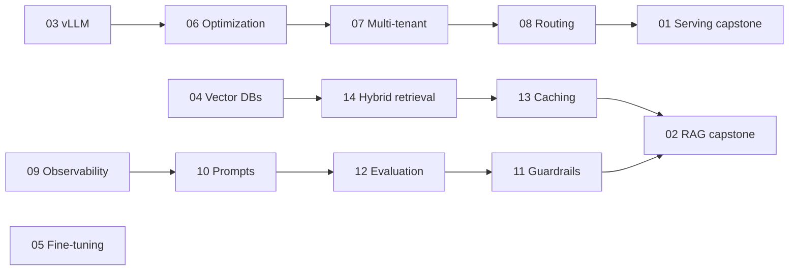

# Module 10: LLM Infrastructure Exercises

Fourteen exercises that follow [Module 10's lessons](../README.md). The first two are large capstone projects. The other twelve are focused, 2–4 hour builds on one topic each.

Every exercise states its own prerequisites and hardware needs at the top. Open it before you start.

## How to work through them

1. Read the matching lesson first.
2. Measure a baseline before you change anything. Most exercises ask for a before-and-after number.
3. Change one thing at a time.
4. Write down what you found, including what did not work.

You are meant to write the code yourself. The exercises give you the task, the things to work out, and a way to check your result.

## The exercises

| # | Exercise | Topic | Time | GPU? |
|---|---|---|---|---|
| 01 | [Production LLM Serving Platform](./exercise-01-production-llm-serving/README.md) | vLLM on Kubernetes, gateway, autoscaling, cost | 30–40 h | Yes |
| 02 | [Production RAG System](./exercise-02-production-rag-system/README.md) | Ingestion, hybrid retrieval, citations, evaluation | 30–40 h | Optional |
| 03 | [vLLM Deep Dive](./exercise-03-vllm-deep-dive/README.md) | Parallelism, caching, structured output, speculation, LoRA | 3 h | Yes |
| 04 | [Vector Database Benchmarking](./exercise-04-vector-db-benchmarking/README.md) | Qdrant vs Weaviate vs pgvector | 3 h | No |
| 05 | [Fine-Tuning at Scale](./exercise-05-finetuning-at-scale/README.md) | LoRA, QLoRA, multi-GPU, adapter serving | 4 h | Yes, 1–4 |
| 06 | [Inference Optimization](./exercise-06-inference-optimization-llm/README.md) | Batching, quantization, KV cache | 3 h | Yes |
| 07 | [Multi-Tenant LLM Platform](./exercise-07-multi-tenant-llm-platform/README.md) | Auth, limits, metering, isolation | 4 h | Yes |
| 08 | [Cost-Aware Routing](./exercise-08-llm-cost-routing/README.md) | Model tiers, routers, escalation | 3 h | Optional |
| 09 | [LLM Observability](./exercise-09-llm-observability/README.md) | Metrics, traces, safe prompt logging, alerts | 3 h | Optional |
| 10 | [Prompt Management](./exercise-10-prompt-management/README.md) | Versioning, A/B tests, CI gates | 2.5 h | No |
| 11 | [LLM Guardrails](./exercise-11-llm-guardrails/README.md) | Injection, moderation, output checks, least privilege | 3 h | Optional |
| 12 | [Evaluation Harness](./exercise-12-llm-evaluation-harness/README.md) | Test sets, LLM judges, regression alerts | 3 h | Optional |
| 13 | [Semantic Caching](./exercise-13-semantic-caching/README.md) | Similarity caches and their risks | 2.5 h | No |
| 14 | [Hybrid Retrieval and Reranking](./exercise-14-hybrid-retrieval-reranking/README.md) | BM25 + dense, fusion, rerankers | 3 h | Optional |

## Suggested order

The exercises build on each other more than the numbers suggest. Start with 03 and 04, do the capstones last, and treat 05 as a side path that connects to [Project 104](../../../projects/project-102-text-to-sql-finetuning/README.md).

## Tools you will need

- Python 3.11 or newer, Docker, `kubectl` (for exercise 01), `git`, `curl`, and `jq`.
- Python packages as each exercise asks. Pin versions in a `requirements.txt` for each exercise, because this field changes quickly.

## Hardware and cost

Rent GPUs only while you use them, and shut them down when you stop.

- A 16–24 GB GPU (such as a T4 or A10G class) is enough for most exercises with 7B–8B models, or with quantization.
- Exercises 05 (multi-GPU step), 03 (tensor parallel step), and 01 benefit from more.
- Specialist GPU rental providers are often much cheaper than large clouds, and spot or preemptible instances cost far less again if your job can restart.
- Check current prices before you start. They change often, so this page does not list them.
- Start with the smallest model that shows the effect you are testing.

## Completion checklist

Tick each one when you have the deliverables, not just a working demo.

- [ ] 01 Serving platform
- [ ] 02 RAG system
- [ ] 03 vLLM deep dive
- [ ] 04 Vector DB benchmark
- [ ] 05 Fine-tuning at scale
- [ ] 06 Inference optimization
- [ ] 07 Multi-tenant platform
- [ ] 08 Cost routing
- [ ] 09 Observability
- [ ] 10 Prompt management
- [ ] 11 Guardrails
- [ ] 12 Evaluation harness
- [ ] 13 Semantic caching
- [ ] 14 Hybrid retrieval

## More help

- [resources.md](../resources.md) has documentation links.
- The [labs](../labs/README.md) walk through the basics each exercise assumes.
