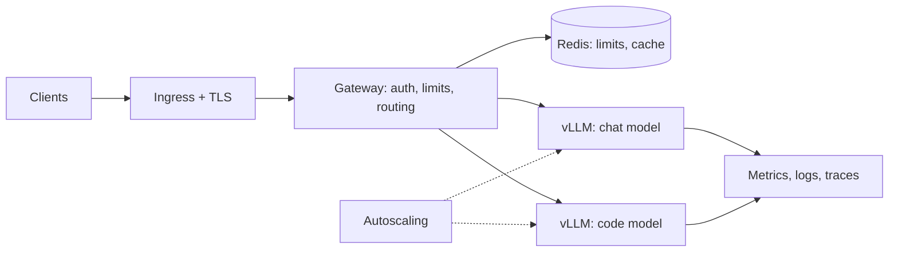

# Exercise 01: Production LLM Serving Platform (vLLM + Kubernetes)

**Estimated time:** 30–40 hours (a capstone, so split it over several weeks)
**Difficulty:** Advanced
**Prerequisites:** Module 04 (Kubernetes), Module 07 (GPU Computing), Module 08 (Monitoring), [Lesson 02: vLLM Deployment](../../02-vllm-deployment.md), and [Lab 01](../../labs/lab-01-vllm-deployment.md)
**Hardware:** A Kubernetes cluster with at least one GPU node (cloud or local). Use the cheapest GPU that fits your model.

This is a project brief. It tells you what to build and how to know it works. It does not hand you the finished code, because writing and debugging it is how you learn it.

## The scenario

A startup runs an AI support product on a hosted LLM API. Three things hurt:

- **Cost.** The API bill is growing about as fast as traffic.
- **Latency.** Responses feel slow, and you cannot tune what you do not control.
- **Data.** A compliance team will not approve sending customer data to a third party in some regions.

Your job is to replace most of that traffic with a self-hosted platform that keeps the same client interface, so migrating a client is a one-line URL change.

The numbers below are the scenario's targets. Treat them as targets to **test**, not facts. Part of your job is to find out whether they are realistic.

| Goal | Target |
|---|---|
| Cost | Meaningfully below the API bill at the same traffic (compute it, see Part 3) |
| Latency | p95 time to first token under 300 ms for chat, at the agreed load |
| Availability | 99.9% over a week of testing |
| Interface | Works with the standard OpenAI client |
| Models | At least two models with different jobs (for example chat and code) |

## What you will build

## Choose your models

Names change every few months, so choose by job and size, and check the licenses:

- A general chat model, 7B–8B parameters, instruction-tuned.
- A code model or a larger general model for harder work.

Use current open-weight models from Hugging Face, and write down why you chose them.

## Part 1: Serve the models (7–9 hours)

**Task.** Deploy each model on Kubernetes with vLLM, as a Deployment plus a Service.

**Things to work out:**
- Which GPU does each model need? Do the memory math: weights, plus KV cache for your target concurrency and context length.
- How do you set `--max-model-len`, `--gpu-memory-utilization`, and `--max-num-seqs`, and what does each trade away?
- Where do the weights come from? A pod that downloads 15 GB on every start will have a very slow cold start. Use a persistent volume or a model cache, and measure your start-up time.
- What do liveness and readiness probes check, given that loading a model takes minutes? A readiness probe that passes too early sends traffic to a pod that cannot answer.
- Install the GPU stack (NVIDIA GPU Operator or your cloud's device plugin) and confirm pods can request `nvidia.com/gpu`.

**Look at:** the vLLM production stack and KServe. Both package much of this for Kubernetes. Decide whether to adopt one or build by hand, and say why.

**Done when:** each model answers an OpenAI-style request from inside the cluster, and you have a measured baseline (tokens per second and TTFT at several concurrency levels) for each.

## Part 2: The gateway (7–9 hours)

**Task.** Build a FastAPI service (or configure an existing gateway) in front of the models. It must provide:

- **Authentication** with API keys that are stored hashed.
- **Routing** by the `model` field of the request.
- **Rate limiting** per key, backed by Redis so it works across several gateway replicas.
- **Streaming** that passes tokens through without buffering the whole reply.
- **Retries and timeouts** that do not make an outage worse (retry only safe cases, with limits and jitter, and cut off requests that run too long).
- **Errors** in the same format the OpenAI client expects.

**Look at:** LiteLLM proxy, Envoy AI Gateway, and the Kubernetes Gateway API Inference Extension. The last one routes using signals such as queue depth and prefix-cache hits, which a plain round-robin balancer cannot see. Write a note on what you would take from them instead of building.

**Done when:** an unmodified OpenAI client works against your gateway for both streaming and non-streaming calls, and a bad key or a rate-limited key gets the right error.

## Part 3: Autoscaling and cost (7–9 hours)

**Task.** Scale the model pods with load, and prove what it costs.

**Things to work out:**
- **What to scale on.** CPU is the wrong signal for a GPU server. vLLM publishes queue and running-request metrics. Scale on those, using KEDA or an HPA with a custom metrics adapter.
- **How fast you can scale.** A new GPU pod needs a node, an image pull, and a model load. Measure it. If it takes 8 minutes, a 3-minute target is not achievable without keeping warm capacity.
- **Cluster scaling.** Configure the cluster autoscaler or Karpenter to add GPU nodes, and think about what happens when GPU capacity is simply not available.
- **Spot instances.** Cheaper, but they can be taken away. Handle the termination notice by draining gracefully, and keep enough on-demand capacity to survive.
- **Scale to zero** for low-traffic models, and the cold-start penalty that comes with it.

**Cost model.** Write a short calculation for the API bill versus self-hosting, at your target traffic:

`monthly cost = GPUs × hourly price × hours` (plus storage, network, and the engineer time to run it)

Compare with `tokens per month × API price per token`. Include utilization: a GPU that is 20% busy is expensive per token. Find the traffic level where self-hosting breaks even. This number is often the most valuable result of the whole exercise, and sometimes it says the API is still cheaper.

**Done when:** load triggers scale-up without dropped requests, idle load scales back down, and your cost sheet uses measured throughput, not guesses.

## Part 4: Observability (5–7 hours)

**Task.** Make the platform visible, using what you learned in [Exercise 09](../exercise-09-llm-observability/README.md).

- Scrape vLLM's `/metrics` plus your gateway's own metrics.
- Build a dashboard for health, latency, saturation, and cost per tenant or per model.
- Add traces across the gateway and the model call.
- Write alerts on user-facing symptoms (high TTFT, error rate, full queue), each linking to a short runbook.

**Done when:** you can break something on purpose and find the cause from the dashboard alone.

## Part 5: Make it safe to run (5–7 hours)

**Task.** Prove it survives real conditions.

- **Zero-downtime updates.** Roll a new model version with readiness gates, `maxUnavailable` set sensibly, and a `terminationGracePeriodSeconds` long enough to finish in-flight requests.
- **Load test.** Use a tool such as `vllm bench serve`, `k6`, or Locust, with realistic prompt lengths and streaming. Test at, below, and above your target load.
- **Failure test.** Kill pods at random, drain a node, and simulate a spot interruption. Watch what clients see.
- **Security basics.** Network policies so only the gateway can reach the models, secrets that are not in images, and no keys in logs.
- **Response cache,** if it makes sense. See [Exercise 13](../exercise-13-semantic-caching/README.md) for why it needs care.

**Done when:** you have a short test report with numbers: the load you handled, how errors behaved during the failure tests, and how long recovery took.

## Acceptance criteria

**Works**
- [ ] At least two models are served and reachable through one gateway.
- [ ] A standard OpenAI client works unchanged, including streaming.
- [ ] Auth, per-key rate limits, and routing work across several gateway replicas.

**Performs** (measure, then report your real numbers next to the targets)
- [ ] Time to first token and throughput at several concurrency levels.
- [ ] Time from load increase to a new pod serving traffic.
- [ ] GPU utilization under sustained load.

**Costs**
- [ ] A written cost model with break-even traffic, based on measured throughput.
- [ ] A clear statement of what runs on spot and what runs on-demand.

**Operates**
- [ ] A rolling update drops no requests.
- [ ] Killing a pod or a node causes only a brief, bounded error blip.
- [ ] A dashboard and alerts exist, and each alert has a runbook.

## Deliverables

1. Kubernetes manifests (or Helm charts) for everything.
2. The gateway code and its tests.
3. Dashboards and alert rules.
4. `COST_MODEL.md` with your assumptions and break-even analysis.
5. `TEST_REPORT.md` with load and failure test results.
6. `RUNBOOK.md` for the three most likely incidents.

## Stretch goals

- **Multi-region:** serve from two regions and route users to the closer one.
- **A/B testing** of a new model against the current one, using [Exercise 12](../exercise-12-llm-evaluation-harness/README.md) to judge it.
- **Per-team cost attribution** with [Exercise 07](../exercise-07-multi-tenant-llm-platform/README.md).
- **Prefill/decode disaggregation** or other advanced serving layouts, if you have the hardware to try them.

## Resources

- [vLLM documentation](https://docs.vllm.ai/)
- [vLLM production stack](https://github.com/vllm-project/production-stack)
- [KServe](https://kserve.github.io/website/)
- [Kubernetes: scheduling GPUs](https://kubernetes.io/docs/tasks/manage-gpus/scheduling-gpus/)
- [KEDA](https://keda.sh/)
- [Gateway API Inference Extension](https://gateway-api-inference-extension.sigs.k8s.io/)
