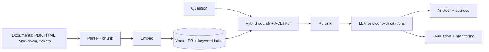

# Exercise 02: Production RAG System

**Estimated time:** 30–40 hours (a capstone, so split it over several weeks)
**Difficulty:** Advanced
**Prerequisites:** [Lesson 03: RAG Systems](../../03-rag-systems.md), [Lesson 04: Vector Databases](../../04-vector-databases.md), [Lab 02](../../labs/lab-02-rag-pipeline.md), and [Exercise 01](../exercise-01-production-llm-serving/README.md) or any working model endpoint
**Hardware:** A laptop can run a small version. A GPU helps for embedding and reranking at scale.

This is a project brief. It says what to build and how to know it works. It does not hand you the finished code, because building and debugging it is where the learning is. For the retrieval details, lean on [Exercise 14](../exercise-14-hybrid-retrieval-reranking/README.md).

## The scenario

A company has ten years of product manuals, internal wiki pages, and support tickets. Its support assistant, which relies on a general model, answers company-specific questions badly: it guesses, and customers notice. Agents step in on most conversations.

You will build an assistant that answers from the company's own documents, shows its sources, and says "I don't know" when the documents do not contain the answer.

| Goal | Target to test |
|---|---|
| Answers are correct and grounded in the documents | Measured on an evaluation set |
| Right passage is found | High recall in the top results |
| Speed | A couple of seconds end to end |
| Scale | Up to about 10,000 queries a day, and a corpus that grows |
| Privacy | Data stays in your infrastructure, and users only see documents they are allowed to see |

You will pick the exact numbers after measuring a baseline. Writing the target before you have a baseline is guesswork.

## What you will build

## Build the evaluation set first

Before writing the pipeline, create 100 or more questions with the passages that answer them, including some questions that have **no answer** in the corpus. Have a person check a sample. Every later decision, such as chunk size, embedding model, and reranker, will be judged against this set.

Keep a locked part you do not tune against.

## Part 1: Ingestion (7–9 hours)

**Task.** Turn raw documents into clean, searchable chunks with metadata.

**Things to work out:**
- **Parsing.** PDFs with tables, headings, and scanned pages are hard. Try a modern document parser (for example Docling, Unstructured, or an OCR-capable model) and compare the output on your hardest files by eye.
- **Chunking.** Compare at least two strategies: fixed size with overlap, and splitting by document structure (headings, sections). Keep the heading path with each chunk. Chunking often matters more than the choice of vector database.
- **Context.** A chunk like "It expires after 30 days" is meaningless alone. Try adding a short context line to each chunk (the document title and section), or generating one with a model. This is often called contextual retrieval.
- **Metadata.** Store the source, the document ID, a version or date, the language, and **who is allowed to see it**.
- **Updates.** Documents change. Design for re-ingesting a changed file, deleting a removed file, and not duplicating chunks. Use stable IDs built from the document and chunk position.

**Done when:** a new, edited, and deleted document each show up correctly in the index, and you can inspect a sample of chunks and find them sensible.

## Part 2: Storage and indexes (6–8 hours)

**Task.** Store chunks for fast dense and keyword search.

**Things to work out:**
- Which vector store, and why? Use what you learned in [Exercise 04](../exercise-04-vector-db-benchmarking/README.md). A database that supports hybrid search and metadata filters in one query saves you work.
- Which embedding model? Compare two or three current open models on your evaluation set, and consider language coverage and context length. Remember that changing the model means re-embedding everything, so keep the model name stored with the data.
- **Access control.** Apply the user's permissions as a filter **inside the search**, not after it. Filtering results afterwards can leave you with nothing and can leak information through counts or timing.
- **Scale.** Estimate memory for your target number of chunks. Know when you would need quantized vectors or sharding.
- High availability: what happens if one node dies?

**Done when:** a search with a user's permissions returns only chunks that user may see, and you have measured latency at your corpus size.

## Part 3: Retrieval (6–8 hours)

**Task.** Build the retrieval step, using what you learned in Exercise 14.

- Run dense and keyword search, fuse the results, and rerank a shortlist.
- Handle a **bad question**: a vague or follow-up question may need to be rewritten into a standalone query first.
- Decide what to do when nothing relevant is found. Use a score threshold or a "no answer" check, so the system can decline.

**Done when:** you have a table that compares dense only, hybrid, and hybrid with a reranker on recall@k and MRR, on your evaluation set, with latency for each.

## Part 4: Generation (5–7 hours)

**Task.** Turn retrieved chunks into a grounded, cited answer.

- Write a prompt that tells the model to use only the context and to cite chunk IDs. Version it as in [Exercise 10](../exercise-10-prompt-management/README.md).
- **Verify citations in code.** Every cited ID must be one you supplied, and a sample of cited passages should truly support the claim.
- Detect unsupported claims (a "faithfulness" check). A judge model can do this on a sample of live traffic.
- Treat retrieved text as **untrusted**. A document can contain instructions aimed at the model. See [Exercise 11](../exercise-11-llm-guardrails/README.md).
- Stream the answer, and show the sources alongside it.

**Done when:** answers carry valid citations, and a question with no answer in the corpus gets an honest "I don't know".

## Part 5: Evaluation and operations (5–7 hours)

**Task.** Measure the whole system and keep it healthy.

- **Retrieval metrics:** recall@k, MRR, and nDCG on the evaluation set.
- **Answer metrics:** faithfulness and correctness, using a calibrated judge. See [Exercise 12](../exercise-12-llm-evaluation-harness/README.md). Tools like Ragas can help.
- **Monitoring:** latency by stage (search, rerank, generation), the share of "I don't know" answers, user thumbs up or down, and cost per query. See [Exercise 09](../exercise-09-llm-observability/README.md).
- **Caching** frequent questions where it is safe. See [Exercise 13](../exercise-13-semantic-caching/README.md).
- **Feedback loop.** Collect failed answers and add them to the evaluation set.
- **Freshness.** Track how old the indexed documents are, and alert when ingestion falls behind.

**Done when:** a dashboard shows quality and speed over time, and an intentionally degraded setup (a worse chunk size, say) is visible in your metrics.

## Acceptance criteria

**Works**
- [ ] PDF, HTML, and Markdown are ingested, and changes and deletions are handled.
- [ ] Hybrid search with a reranker, and with permissions applied inside the search.
- [ ] Answers cite real chunks, and out-of-scope questions are declined.

**Measured**
- [ ] An evaluation set with a locked portion, and a results table for each retrieval setup.
- [ ] Faithfulness and correctness measured with a validated judge.
- [ ] Latency per stage, and end-to-end under load.

**Safe**
- [ ] A user can never retrieve a document they are not allowed to see (test this explicitly).
- [ ] A document containing injected instructions does not hijack the answer.

**Operable**
- [ ] A dashboard, alerts, and a runbook.
- [ ] A way to re-index with a new embedding model without downtime.

## Deliverables

1. The ingestion, retrieval, and generation code with tests.
2. The evaluation set, scoring code, and results.
3. Deployment manifests for the vector store and services.
4. Dashboards and alerts.
5. `DESIGN.md`: the choices you made and what each one contributed, using your measurements.
6. `LIMITS.md`: where the system fails, and what you would do next.

## Stretch goals

- **Multimodal RAG** for tables, charts, and screenshots (look at vision-language retrieval models).
- **Conversational RAG** with follow-up questions.
- **Agentic RAG,** where the model decides when to search again or which source to use, and the extra cost and risk that adds.
- **GraphRAG** for questions that connect many documents. Measure whether it beats plain hybrid search before adopting it.

## Resources

- [Qdrant documentation](https://qdrant.tech/documentation/)
- [Sentence Transformers](https://www.sbert.net/)
- [MTEB leaderboard (embedding models)](https://huggingface.co/spaces/mteb/leaderboard)
- [Ragas](https://docs.ragas.io/)
- [Original RAG paper (Lewis et al., 2020)](https://arxiv.org/abs/2005.11401)
