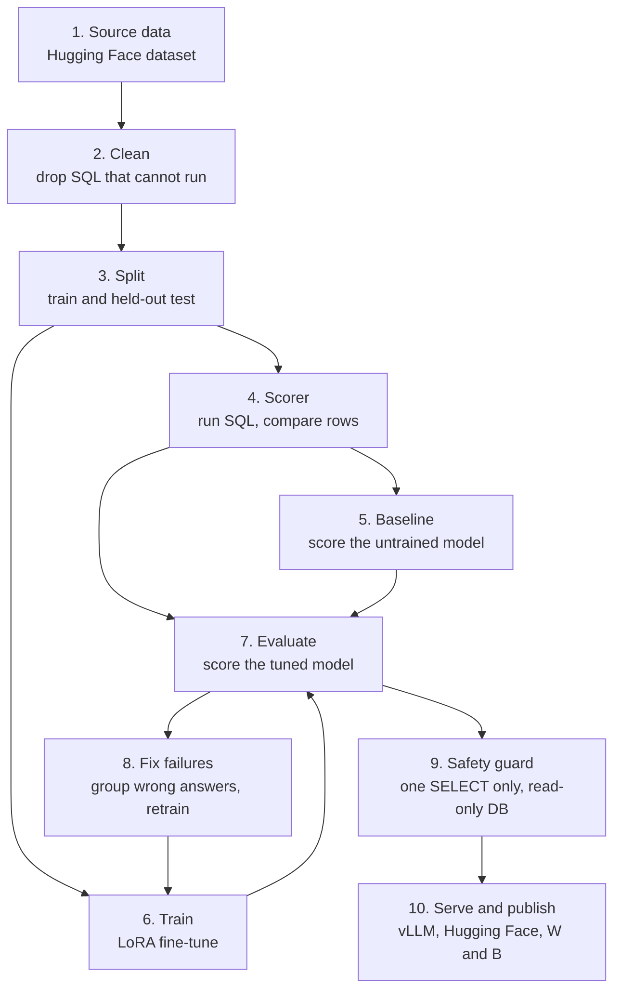
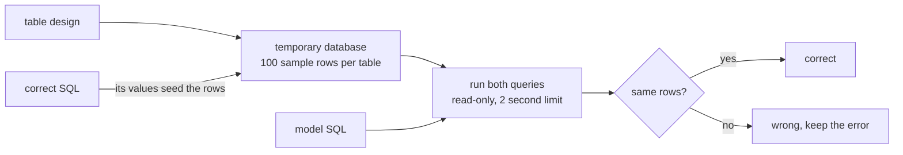

# Architecture: Text-to-SQL Fine-Tuning

## What the system is

A business user types a question, such as "how many orders did we get last month?". The system sees that question and the table design, and it writes a SQL query. A small open model does the writing. We **fine-tune** that model on tens of thousands of question and SQL pairs, **measure** it by running its queries against a database, and **guard** the output so nothing unsafe can run.

```
question + table design  ->  model  ->  SQL  ->  safety check  ->  read-only database  ->  answer
```

This document explains each part of the system, why it exists, and what we decided. Status is marked **done** or **planned (phase N)**.

---

## 1. The whole pipeline in one picture



Steps 1 to 4 are **done** and run on the Mac. Steps 5 to 8 run on Colab's free GPU (planned, phases 2 to 4). Step 9 is planned (phase 5), and step 10 is planned (phase 6).

---

## 2. Each part: what, why, and what we decided

### Step 1: Source data (done)

**What:** the public dataset `b-mc2/sql-create-context`. It holds 78,577 rows of `question`, `context` (the table design) and `answer` (the correct SQL).

**Why it is needed:** fine-tuning needs many examples of the exact task. Writing our own would take weeks.

**Decisions:**
- **Pin the dataset to one exact version** (a commit hash). *Why:* if the author edits the dataset later, our train and test sets would change silently, and our baseline and fine-tuned scores would no longer be comparable.
- **Use a public dataset, not a private one.** *Why:* anyone can reproduce our results, which is the point of a showcase.

### Step 2: Clean (done)

**What:** drop any row whose table design or correct SQL fails to run in SQLite. About 2.1% were dropped (78,577 to 76,910).

**Why it is needed:** the scorer compares a model's query with the correct query by running both. If the "correct" query is itself broken, there is nothing to compare against, and the row would count as a miss for no reason. Training on broken SQL also teaches the model bad habits.

**Decisions:**
- **Filter before splitting.** *Why:* it keeps the test set clean, and every test question can be scored.
- **Alternative rejected:** keep everything and ignore the errors. *Why not:* it lowers the score for reasons that have nothing to do with the model.

### Step 3: Split into train and test (done)

**What:** 76,446 rows to train on and 200 held back to test. Duplicate questions are removed first, and a fixed seed makes the split the same every time.

**Why it is needed:** testing on questions the model studied proves nothing. The test set is the exam the model has never seen.

**Decisions:**
- **Remove duplicate questions before splitting.** *Why:* the same question in both sets is "leakage" and inflates the score.
- **Fixed seed plus a manifest of checksums.** *Why:* the baseline run and the fine-tuned run must use the identical 200 questions, and Colab must prove it loaded identical data.
- **Only 200 test rows.** *Why:* enough to see a clear gain, small enough to score in minutes. *Trade-off:* small differences are noise.

### Step 4: The scorer (done)

**What:** a function that builds a throwaway SQLite database from the table design, fills it with sample rows, runs the correct query and the model's query, and checks whether the **results** match.



**Why it is needed:** it is the only way to measure the model honestly. Every later phase depends on it.

**Decisions:**
- **Compare results, not text.** *Why:* `SELECT name FROM emp` and `SELECT emp.name FROM emp` are different text with the same answer. Text matching would call correct answers wrong.
- **Ignore row order unless the correct query has `ORDER BY`.** *Why:* without it, SQL does not promise any order.
- **Fill the tables with sample rows, seeded from the correct query's values.** *Why:* the dataset has no real data. With random rows, 112 of 200 correct queries returned nothing, so wrong queries could "match" by also returning nothing. Seeding cut that to 6.
- **Read-only database and a 2 second limit.** *Why:* model output is untrusted. A `DELETE` must do nothing, and a runaway query must stop.
- **Treat invalid SQL and timeouts as wrong, and keep the error text.** *Why:* the errors are what we analyse in step 8.
- **Alternative rejected:** exact string match. *Why not:* it under-counts correct answers.

### Step 5: Baseline (planned, phase 2)

**What:** run the untrained model on the 200 test questions and score it.

**Why it is needed:** you cannot claim an improvement without a number to beat. It also tells us which small model to start from.

**Decisions:**
- **Same prompt, same decoding, same 200 questions as the final run.** *Why:* the only difference between the two scores must be the training.
- **Greedy decoding (no randomness).** *Why:* repeatable results.
- **Pick the base model by baseline score, among 0.5B to 1.5B code models.** *Why:* it must fit a free T4 GPU, and a code-aware model starts higher.

### Step 6: Train (planned, phase 3)

**What:** fine-tune the model with **LoRA**, which trains a small add-on (under 2% of the weights) and leaves the rest frozen. If memory is tight, we use **QLoRA**, which also stores the frozen part in 4 bits.

**Why it is needed:** this is the learning step that makes the model good at our task.

**Decisions:**
- **LoRA/QLoRA, not full fine-tuning.** *Why:* full fine-tuning needs far more GPU memory than the free T4 has, and the saved result is a small file, not a full model copy.
- **One shared prompt format** for training, scoring and serving. *Why:* a model trained on one format and tested on another scores badly for the wrong reason.
- **Learn from the SQL answer only, and end with a stop token.** *Why:* it teaches the output, and prevents the model that never stops generating.
- **Log every run to Weights & Biases.** *Why:* it lets us say which run was best and why, and it is public proof of real training.
- **Train on Colab.** *Why:* free GPU, and the notebook can be made public.

### Step 7: Evaluate (planned, phase 4)

**What:** score the tuned model on the same 200 questions, using the same scorer.

**Why it is needed:** it turns "the loss went down" into the number that matters: how many queries return the right rows.

**Decision:** report execution accuracy next to the invalid-SQL rate. *Why:* a model can improve by writing fewer broken queries without getting more answers right, and we want to see both.

### Step 8: Fix failures (planned, phase 4)

**What:** group the wrong answers by cause (invalid SQL, wrong column, wrong filter, wrong aggregation), fix the largest group with more targeted examples, retrain, and score again.

**Why it is needed:** this is how real teams improve a model. It also produces the most useful part of the write-up.

**Decisions:**
- **Fix the biggest group first.** *Why:* it gives the largest gain for the effort.
- **Never tune against the 200 test questions.** *Why:* if we do, the final number is no longer honest. We set aside a second untouched set for the final score if needed.
- **Optional DPO** on the failures. *Why:* it teaches the model to prefer the right answer over its own wrong one, but it only helps if SFT is already working.

### Step 9: Safety guard (planned, phase 5)

**What:** before any generated SQL runs, parse it, accept only a single `SELECT` on allowed tables, then run it on a read-only connection with a row limit and a timeout.

**Why it is needed:** a fine-tuned model does not reliably refuse to write `DROP TABLE`. In a real system a bad query could delete data or leak a restricted table.

**Decisions:**
- **Enforce safety outside the model, in layers.** *Why:* if one layer misses something, another catches it.
- **Parse the SQL with a SQL parser, not string matching.** *Why:* comments and odd spacing defeat string checks.
- **Read-only database as the final layer.** *Why:* it is the strongest layer, because the database itself refuses writes.

### Step 10: Serve and publish (planned, phase 6)

**What:** serve the tuned model with vLLM, upload the adapter to Hugging Face, and write the results and links into the README.

**Why it is needed:** serving shows the model works as a service, and publishing makes the work verifiable.

**Decisions:**
- **vLLM for serving.** *Why:* it is the standard high-throughput LLM server, and it can load a LoRA adapter.
- **Serve inside Colab, or on a rented GPU for about an hour. No always-on endpoint.** *Why:* the goal is to learn and show, so the cost stays near zero. vLLM needs an NVIDIA GPU, which a Mac does not have.
- **Hugging Face for the adapter, W and B for runs, GitHub for code.** *Why:* these are the places engineers look, and each link can be checked.

---

## 3. Where each part runs

| Part | Runs on | Why there |
|---|---|---|
| Steps 1 to 4 (data, scorer) | Mac, CPU | No model is loaded, so no GPU is needed |
| Steps 5 to 8 (baseline, train, evaluate, fix) | Colab, free T4 | Loading a model needs a GPU |
| Step 9 (guard) | Mac, CPU | Only parses and runs SQL |
| Step 10 (serve) | Colab or a rented GPU | vLLM needs an NVIDIA GPU |

The repo is the source of truth. A Colab notebook only clones it and calls its scripts, so the same tested code runs everywhere.

---

## 4. Code layout

| File | Job | Status |
|---|---|---|
| `src/data.py` | Load, clean, dedupe, split, write the manifest | done |
| `src/run_sql.py` | Sandbox and scorer | done |
| `src/check_references.py` | Check that every test reference runs | done |
| `src/prompt.py` | One prompt format for training, scoring and serving | planned (phase 2) |
| `src/eval.py` | Score a model on the test set and report failure types | planned (phase 2) |
| `src/train.py` | LoRA/QLoRA training with W and B logging | planned (phase 3) |
| `src/guard.py` | The SQL safety check | planned (phase 5) |
| `src/serve.py` | vLLM serving with the guard in front | planned (phase 6) |
| `tests/` | Unit tests, later an accuracy regression test | partly done |
| `notebooks/` | Thin Colab runners | planned |

Filenames for planned parts may change as we build.

---

## 5. Making every result reproducible

| Mechanism | What it guarantees |
|---|---|
| Pinned dataset version | Same data on every machine and date |
| Fixed seeds | Same split, and comparable training runs |
| Manifest with checksums | Proof that Colab used identical data |
| Pinned `requirements.txt` | Same library versions |
| Tests (`make test`) | Splitting and scoring behave as specified |
| Accuracy regression test (planned) | Automated check that fails if the score drops |
| `notes.md` | Every run's numbers, errors and fixes |

---

## 6. Cost

Everything costs nothing except an optional hour of rented GPU for the serving demo, a few dollars at most. The costs are Mac (free), Colab free T4 (free, availability and session length vary), Hugging Face (free), Weights and Biases (free tier).

---

## 7. Known limits

- The test set holds only questions whose SQL SQLite can run.
- The sample rows are made up, so two different queries can still agree by chance.
- The dataset is mostly single-table, so results do not predict how it would do on a large company schema.
- Duplicate removal catches identical questions, not reworded ones.
- Scores come from 200 questions, so small differences are noise.
