# Harmful Content Detection System Design

A proactive moderation system for a large social platform (similar to Facebook, LinkedIn, Twitter) that monitors new posts, predicts whether they contain harmful content (violence, nudity, self-harm, hate speech, etc.), and removes or demotes violating posts while telling the author why.

---

## 1. Requirements & System Constraints

### Business Objectives
*   **Core Goal:** Make the platform safe by detecting posts that violate community guidelines and enforcing on them (remove or demote).
*   **Scope:** Detect harmful **content** only. Bad actors (fake accounts, spam, phishing) are out-of-scope, and so is misinformation (too complex and controversial).
*   **Explainability:** Users must be told *why* a post was removed so they can align future posts with the guidelines.
*   **Feedback Mechanism:** Users can report harmful posts and appeal removals.

### Technical & Scale Constraints
*   **Scale:** 500M+ new posts per day.
*   **Modalities:** A post can be text, image, video, or any combination of these.
*   **Languages:** Multilingual. Assume a pre-trained multilingual model embeds the text.
*   **Human Labeling:** Only about 10,000 posts per day can be labeled by human annotators.
*   **Latency:** Varies by harm type. Violence needs real-time detection and blocking; other classes tolerate late (batch) detection.

---

## 2. Problem Formulation

### Business & ML Objective
*   **Primary Objective:** Accurately predict harmful posts, so they can be removed or demoted to make the platform safer.

### Define Inputs and Outputs
*   **Input:** A post, which is heterogeneous and potentially multimodal (text, image/video, author, comments, context).
*   **Output:** The probability that the post is harmful, broken down per harm class (violence, nudity, hate speech, etc.).

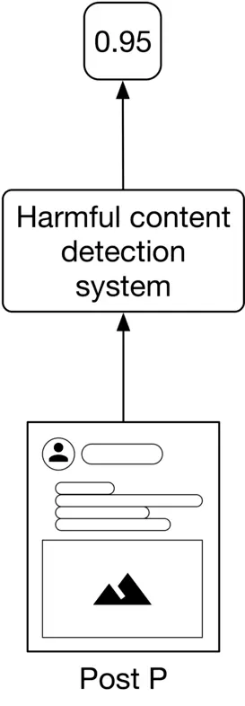

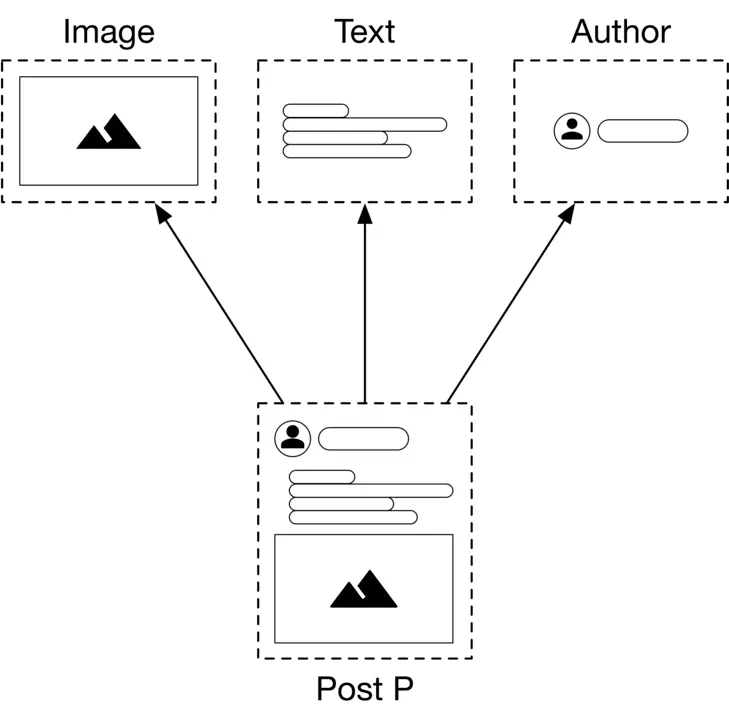

### Fusing Modalities: Late vs. Early Fusion
**Why this question appears at all:** Our input (a post) is heterogeneous: text, image, video and author data are different data types, and no single model reads all of them directly. So we must decide *where* to combine them. "Fusion" is just that decision.

*   **Late fusion** = combine **predictions** (late in the pipeline).
*   **Early fusion** = combine **features** (early in the pipeline), then predict once.

#### How Late Fusion works (step by step)
1.  Split the post into modalities: image, text, author.
2.  Run a **separate model per modality** (Model 1 on image, Model 2 on text, Model N on author). Each outputs its own harm score.
3.  A **fusion layer** (e.g., average, max, or a small learned combiner) merges these scores into one final harm probability.

#### Where Late Fusion breaks: the hateful meme problem
This is the most important example to know for interviews. Suppose a post has:

| Modality | Content | Model's harm score |
|---|---|---|
| Image alone | A person smiling | 0.05 |
| Text alone | "You don't belong here." | 0.20 (benign-looking without context) |
| **Combined meaning** | The caption targets the person or group in the image | Hateful or exclusionary, depending on the image, target and context |

A simple average fusion layer only receives those two scores:

$$P_{\text{late}} = \frac{0.05 + 0.20}{2} = 0.125$$

With a 0.5 threshold, the post is classified as **benign**, even though the combination may communicate a harmful message that neither modality reveals alone.

**Why it happens: information loss before fusion.** The image model compressed a rich image into one number. The text model compressed a sentence into another. The fusion layer sees those numbers, not the image-text relationship. Once that relationship is discarded, a simple score combiner cannot reconstruct it.

**Fair caveat (say this in the interview):** Late fusion does not *always* fail on memes. A well-trained learned combiner can pick up useful patterns across modality scores. The limitation is that it cannot recover cross-modal information that the component outputs never retained.

**Second problem:** training Models 1..N needs a separate labeled dataset per modality, which is slow and expensive when human labels are scarce.

#### How Early Fusion works (step by step)
The idea: preserve useful information from every modality until one shared model can learn how they relate.
1.  **Encode the image.** An image encoder (e.g., a vision transformer or CLIP's visual encoder) turns the picture into an embedding, e.g., `[0.2, 0.8, -0.1, 0.4, ...]`.
2.  **Encode the text.** A text encoder (e.g., DistilmBERT) turns the caption into its own embedding, e.g., `[0.7, -0.2, 0.3, 0.9, ...]`.
3.  **Encode author metadata.** Numeric or categorical features (account age, posting frequency) are normalized or embedded. Avoid including sensitive attributes casually, because metadata can introduce bias and privacy risk.
4.  **Fuse the representations.** The simplest way is concatenation, joining the vectors end to end:

    $$z = [z_{\text{image}} ; z_{\text{text}} ; z_{\text{author}}]$$

5.  **Learn cross-modal patterns.** A neural network reads the fused vector. It can learn that certain image features *combined with* certain text features indicate harm, even when each modality alone looks harmless.
6.  **Predict once.** The model outputs the harm scores, and the system applies its decision thresholds or routes uncertain cases to human review.

| Aspect | Late Fusion | Early Fusion (Chosen) |
|---|---|---|
| How it combines | Merges per-modality **predictions** at the end | Merges **features** first, one model predicts |
| Training data | Separate labeled set per modality | One dataset for one model |
| Cross-modal harm (memes) | Misses it if each part is benign | Can capture it in the unified vector |
| Independent iteration | Yes, improve each model alone | No, one model for everything |
| Main risk | Wrong answer on combined harm | Harder to learn modality interactions with little data |

**Decision:** Early fusion. It catches posts that are harmful only in combination, and 500M posts per day give enough data to learn the harder cross-modal relationships. **This fused vector is exactly the input to the classifier we choose next.**

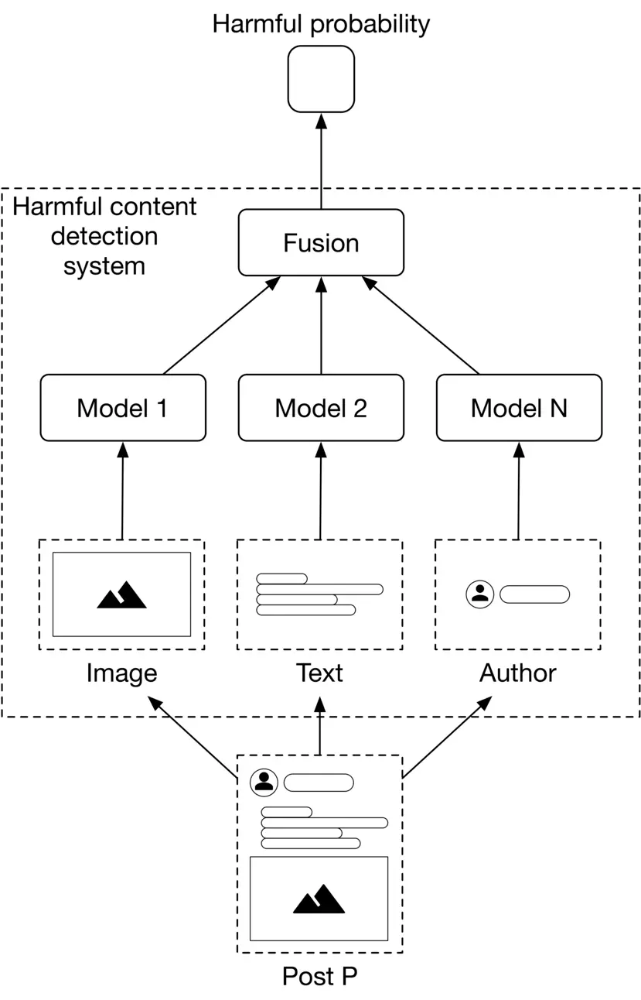
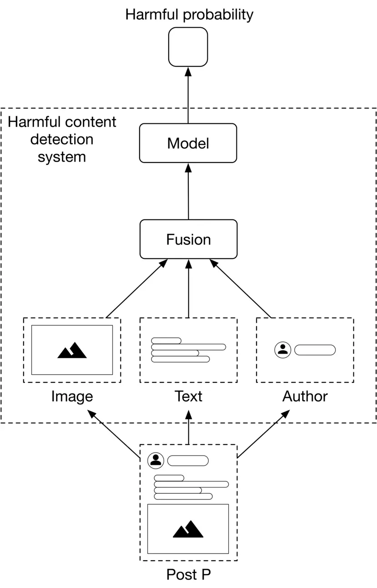

### Choose the ML Category
**Connection:** The fused features are the input. Now we decide what comes *out*. Our requirement "explain why a post was removed" rules out anything that returns only one harmful/not-harmful score. We look at four options:

1.  Single binary classifier
2.  One binary classifier per harmful class
3.  Multi-label classifier
4.  Multi-task classifier (chosen)

#### Option 1: Single Binary Classifier
**What it is:** One model reads the fused features and answers one question: *"Is this post harmful, yes or no?"* It outputs a single harmful probability.

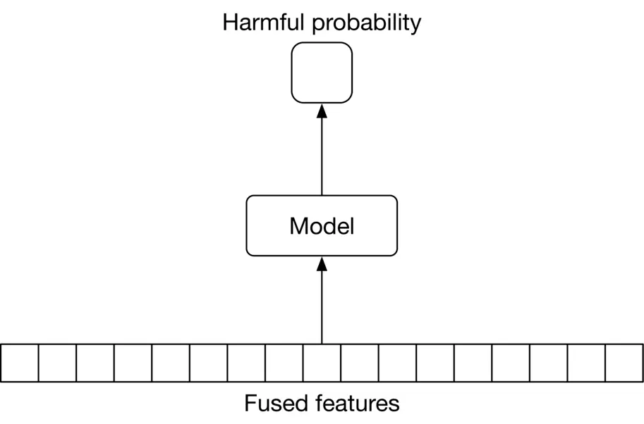

**In simple words:** Think of a security guard who can only say "stop" or "go". He never tells you *why*.

**The problem:**
*   We cannot tell the user why their post was removed, because the model never says which kind of harm it saw (violence? hate?).
*   We cannot find which harm types the model is bad at, so we cannot improve them.

**Verdict:** Not good enough, because explaining removals is a requirement.

#### Option 2: One Binary Classifier per Harmful Class
**What it is:** We build a separate yes/no model for each harm type: one for violence, one for nudity, one for hate, and so on. Each reads the same fused features.

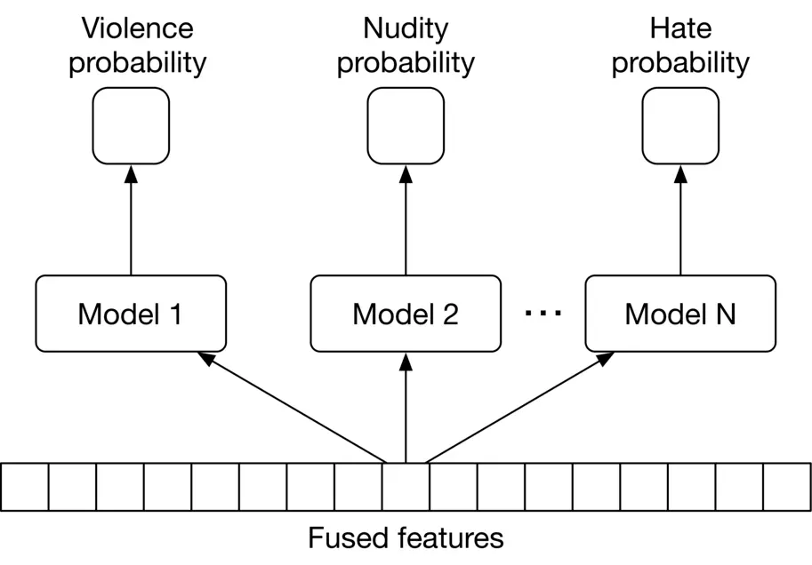

**In simple words:** A team of specialist guards. One watches only for violence, another only for nudity. If the violence guard shouts, we know the reason.

**Advantage:** We can explain the takedown, and we can monitor and improve each model on its own.

**The problem:** Many models means many things to train, deploy and maintain. That is slow and expensive.

#### Option 3: Multi-Label Classifier
**What it is:** *Multi-label* means one post can belong to **several classes at once** (a post can be violent *and* hateful). One single model reads the fused features and outputs a probability for every harm class together.

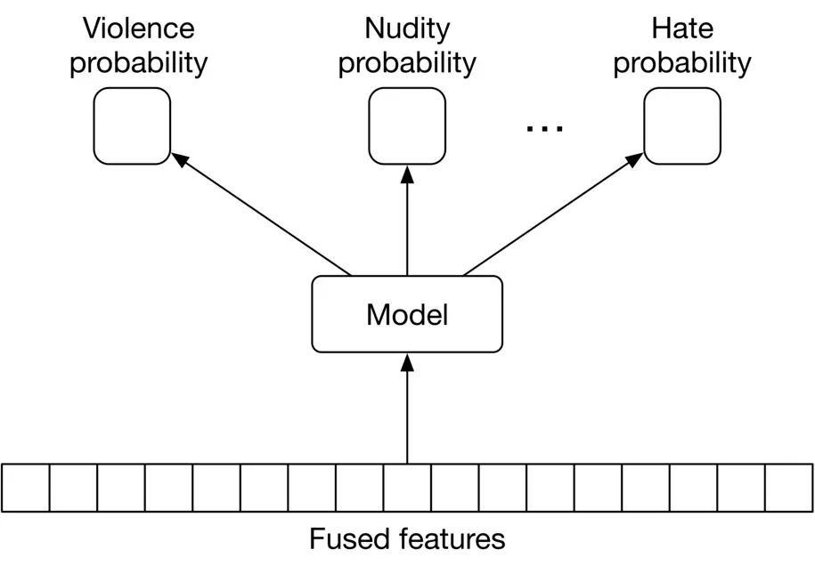

**In simple words:** One guard who fills in a checklist: violence 0.89, nudity 0.10, hate 0.70.

**Advantage:** One shared model is cheaper to train and maintain than many (Facebook's WPIE approach works this way).

**The problem:** All classes share the exact same view of the features, but each class may need the features transformed differently. For example, spotting nudity needs different cues than spotting hate speech.

#### Option 4: Multi-Task Classifier (Chosen)
**What it is:** *Multi-task learning* means one model learns **several tasks at the same time**, so it can notice what the tasks have in common and avoid repeating work. Here, each harm class (violence, nudity, hate, ...) is its own task.

**In simple words:** One school with one shared foundation course, then separate specialist classes. Everyone first learns the basics together (shared layers), then each student specializes in one subject (task head).

The model has two stages:

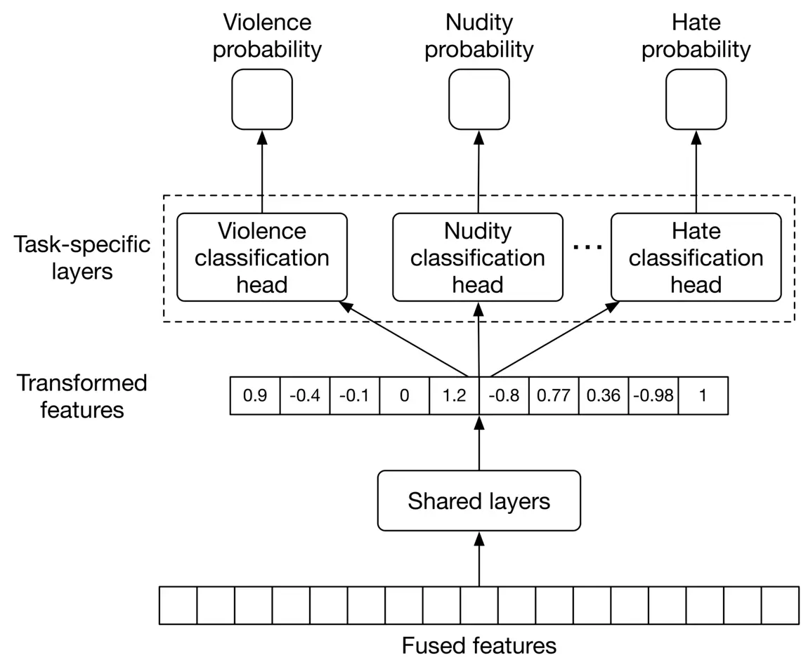

**Stage 1: Shared layers.** A set of hidden layers that turns the fused input features into new, more useful **transformed features**. These are reused for *every* harm class, so common work (like understanding how the image and text relate) is done once instead of once per class.

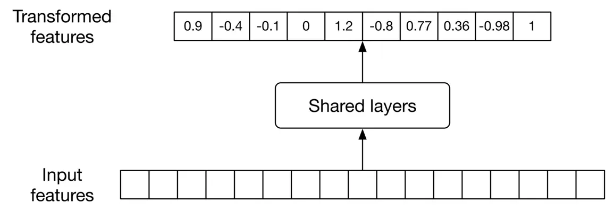

**Stage 2: Task-specific layers (classification heads).** Independent layers, one per harm class. Each head takes the shared features and reshapes them in the way that is **best for its own class**, then outputs that class's probability (violence probability, nudity probability, hate probability, ...).

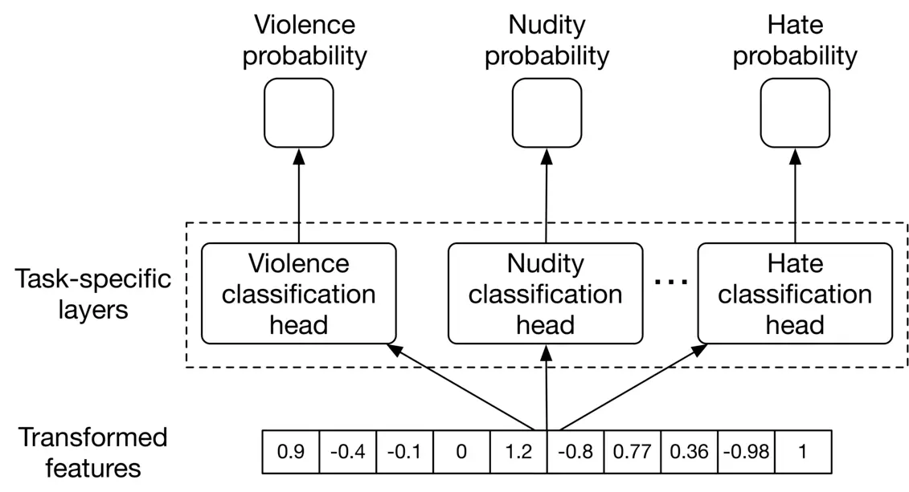

**Why we choose it:**
*   **Cheap to train and maintain:** one model, not one per class.
*   **No repeated work:** the shared layers transform the features once for all classes.
*   **Fixes the multi-label problem:** each head still gets its own class-specific transformation.
*   **Tasks help each other:** data for one class improves the shared layers used by all the others. This helps most for rare harms that have little data.
*   **Explainable:** the head that fires tells us *which* class to cite when we tell the user why the post was removed.

#### Quick Comparison
| Option | Explains *why*? | Number of models | Class-specific features? | Verdict |
|---|---|---|---|---|
| Single binary | No | 1 | No | Rejected: cannot explain |
| One binary per class | Yes | Many | Yes | Rejected: expensive to maintain |
| Multi-label | Yes | 1 | No | Close, but weaker per class |
| **Multi-task** | **Yes** | **1** | **Yes** | **Chosen** |

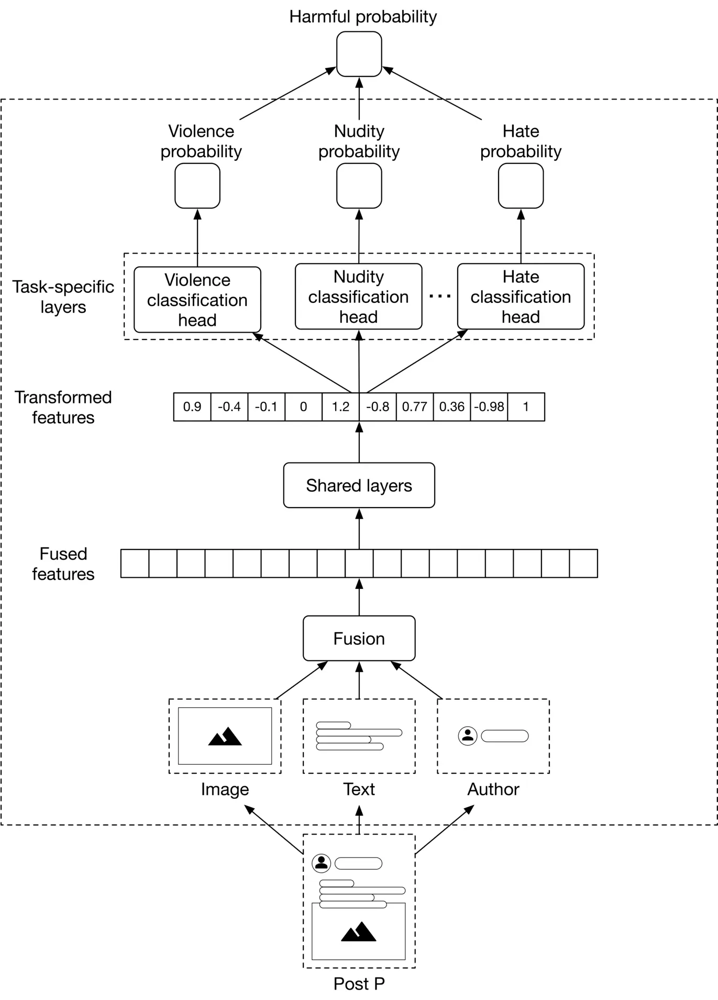

---

## 3. Data Preparation & Engineering

In Section 2 we chose a multi-task model that reads **one fused feature vector per post** (early fusion). Now we build that vector. First we look at what data we have. Then we turn each kind of data into numbers and join them together.

### Data Sources
1.  **Users:** ID, username, age, gender, city, country, email.
2.  **Posts:** Post ID, author ID, on-device IP, timestamp, text, image/video URLs, links. In practice, a post has hundreds of attributes.
3.  **User-Post Interactions:** Impressions, likes, comments, saves, shares, **reports** (with the reported class, e.g., `violence`), and appeals. Each has a timestamp.

### Feature Engineering
The model needs numbers, but a post is made of text, media, reactions, author details and context. So each kind of data gets its own small pipeline, and all the outputs are joined (concatenated) into one vector. There are five groups.

#### Step 1: Text of the Post
*   **Clean the text:** Normalize it and split it into tokens.
*   **Turn it into a vector:** BoW and TF-IDF are fast, but they do not understand meaning. So we use a pre-trained Transformer.
*   **Why DistilmBERT, not BERT:** BERT is slow (bad for online prediction) and works only for English. DistilmBERT is smaller, faster and multilingual. The same sentence in two languages gets similar vectors.

#### Step 2: Image or Video
*   **Prepare the media:** Decode, resize and normalize it.
*   **Turn it into a vector:** A pre-trained model does this. For images we use CLIP's visual encoder or SimCLR. For videos we use models like VideoMoCo.

#### Step 3: User Reactions to the Post
Sometimes the post alone is not clear. Reactions give extra hints. For example, if more and more people leave supportive comments on a self-harm post, our confidence that it is harmful goes up.
*   **Counts of likes, shares, comments and reports:** We scale them so training converges faster.
*   **Comments:** We embed them with the same text model from Step 1. Then we **average-pool** them, which means averaging all comment vectors into one vector.

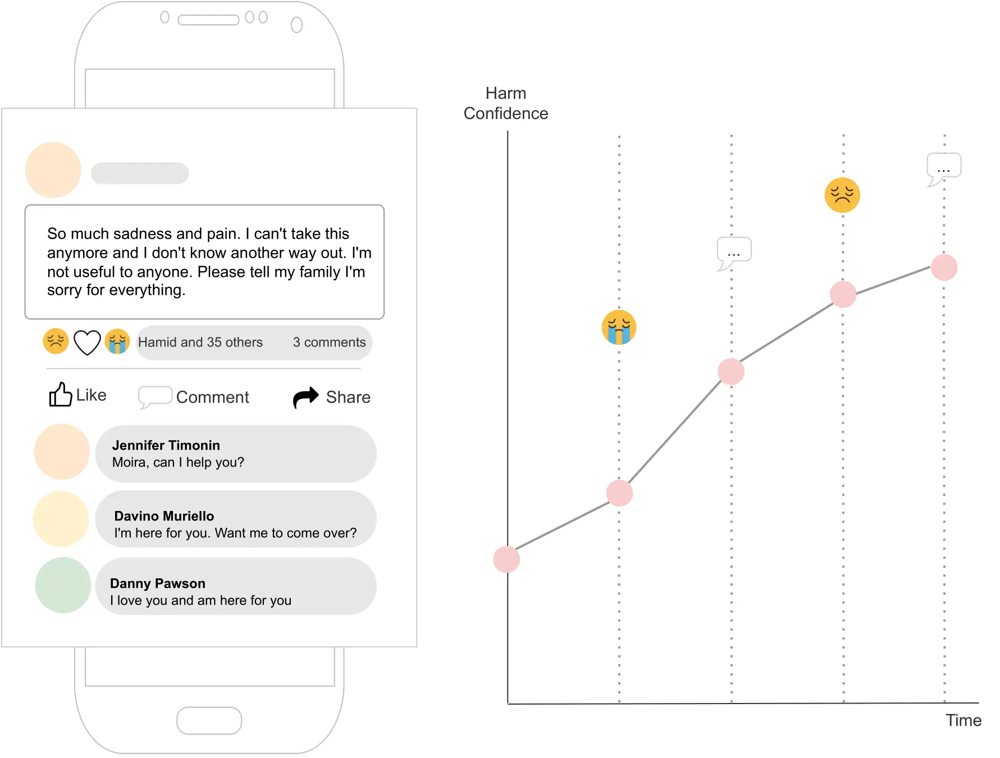

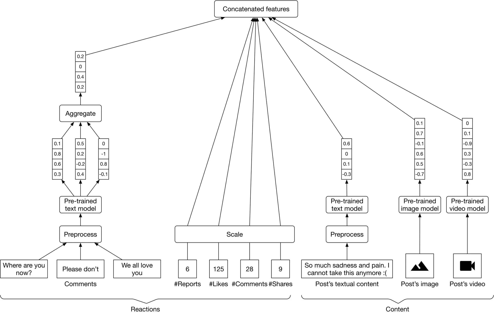

#### Step 4: Author Features
Who wrote the post also matters.
*   **Past violations:** Number of earlier violations, total user reports against the author, and how often they used profane words (from a fixed word list) in old posts and comments.
*   **Demographics:** Age is one of the strongest signals. Gender is one-hot encoded. City and country go through an embedding layer, because one-hot would be very long and mostly zeros.
*   **Account info:** Number of followers and followings, and account age. New accounts are more likely to be spam or rule breakers.

#### Step 5: Context
*   **Time of day:** Split into morning, noon, afternoon, evening and night, then one-hot encoded.
*   **Device:** Smartphone or desktop, one-hot encoded.

#### Putting It Together
We concatenate the vectors from all five steps. The result is the **fused feature vector**. It goes into the shared layers of the multi-task model, which we designed in Section 2.

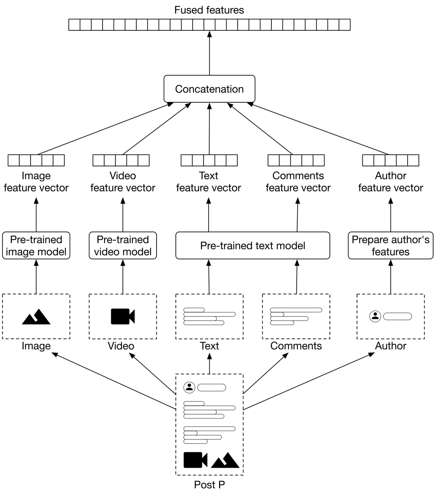

---

## 4. Model Development & Training

In Section 3 we built the fused feature vector for every post. Now we pick the model that reads this vector, build the training data, and decide how the model learns.

### Model Selection
Section 2 chose a multi-task design: shared layers first, then one head per harm class. A **neural network** fits this best, because it can have shared layers and separate heads inside one model.

We still need to choose the network's settings: the number of hidden layers, the size of each layer, the activation function and the learning rate. We do this with **hyperparameter tuning**, usually **grid search**:
1.  List a few values for each setting.
2.  Train one model for every combination.
3.  Evaluate each one and keep the best.

### Constructing the Dataset
A training example needs two things: the **input** (the fused features) and the **label** (the answer we want the model to learn).

**Inputs.** We compute the fused features offline, in batches, and save them in a **feature store**. Later training runs can reuse them without recomputing.

**Labels.** Our model has one output per harm class, so a label is a list of 0s and 1s, one for each class. For example, `[0, 0, 1, 1, 0]` for (nudity, illegal goods, violence, self-harm, hate speech) means the post is violent and shows self-harm. A post can have more than one 1, because harms can overlap.

We can get these labels in two ways:

| Aspect | Hand Labeling | Natural Labeling |
|---|---|---|
| **How it works** | Human contractors read each post and label it | We use user reports (each report names a class) as labels |
| **Quality** | Accurate | Noisy (people report wrongly, or miss harmful posts) |
| **Cost / Speed** | Expensive and slow | Cheap and fast |
| **Used for** | **Evaluation set** (accuracy first) | **Training set** (speed first) |

We use each method where it is strongest. Training needs a lot of data, so we use cheap natural labels and accept some noise. The evaluation set tells us how good the model really is, so we spend money on accurate hand labels.

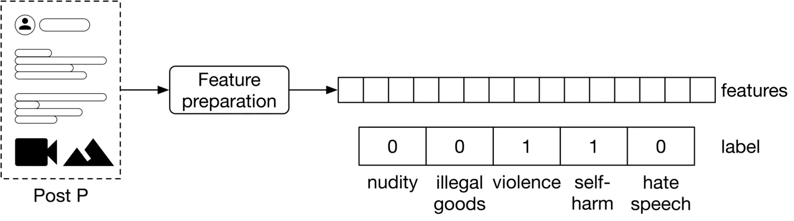

### Loss Function
Training repeats one loop:
1.  **Forward pass:** the model reads the features and predicts a probability for each class.
2.  **Loss:** a function measures how wrong the predictions are.
3.  **Backward pass:** the model updates its weights to make the loss smaller next time.

In multi-task training, every task gets its own loss. Each task is a yes/no question ("is it violent?"), so each head uses **binary cross-entropy**. For one task, with true label `y` (0 or 1) and predicted probability `p`:

$$L = -\big[\,y\log p + (1-y)\log(1-p)\,\big]$$

In simple words: if the post is truly violent (`y = 1`), the loss is small when `p` is close to 1 and large when `p` is close to 0.

The overall loss is the **sum of all task losses**:

$$\text{Loss} = L_1 + L_2 + \dots + L_n$$

Because the shared layers feed every head, they receive learning signals from all tasks at once. That is how the tasks help each other.

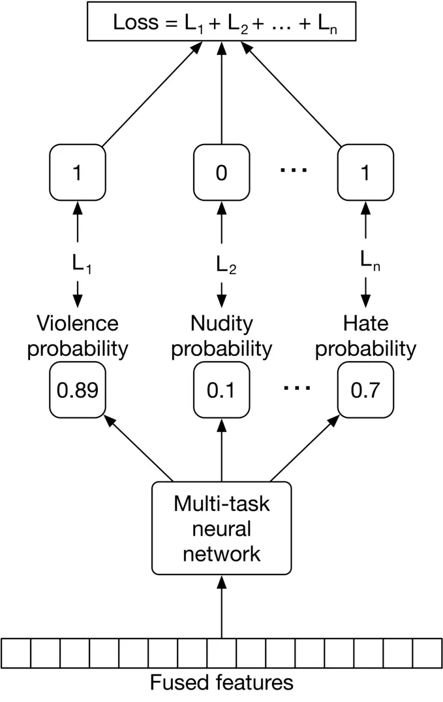

### Overfitting in Multimodal Training
Our input mixes several modalities (text, image, reactions and so on), and they do not all learn at the same speed. One modality, such as the image, can learn fastest and **dominate** training. The model then leans on it too much, overfits to it, and under-uses the others.

Two common fixes:
*   **Gradient Blending:** Give each modality's gradient a weight, based on how much it is overfitting, so no single modality takes over.
*   **Focal Loss:** Make easy examples count less in the loss, so the model spends its effort on hard examples.

---

## 5. Evaluation

**Connection:** Offline metrics are computed on the **hand-labeled** set (trusted), per harm class. Online metrics check the real goal: fewer people seeing harmful content, without over-removing.

### Offline Metrics
Precision or recall alone is not enough (high precision can hide very low recall), so we use curve-based metrics, computed per class:
*   **PR-AUC:** Area under the precision-recall curve, built by sweeping the probability threshold from 0 to 1. Useful for imbalanced classes like harm.
*   **ROC-AUC:** Area under the true positive rate vs. false positive rate curve.

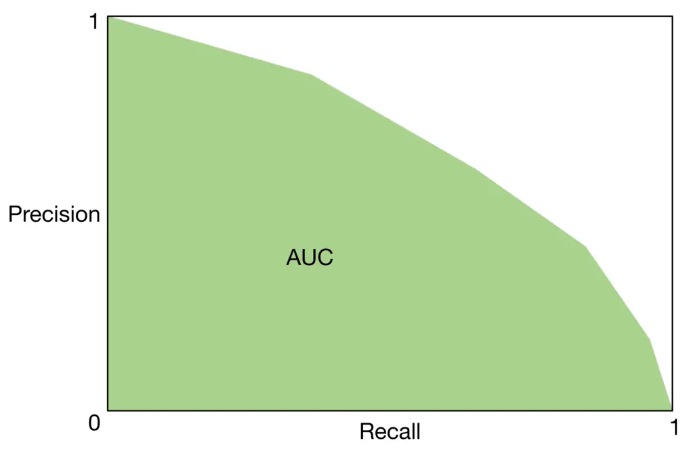

### Online Metrics
*   **Prevalence:** $\frac{\text{harmful posts we didn't prevent}}{\text{total posts}}$. Weakness: treats a post with 100K views the same as one with 10 views.
*   **Harmful Impressions (preferred):** Counts how many people actually saw harmful posts, so it reflects real impact.
*   **Valid Appeals:** $\frac{\text{reversed appeals}}{\text{harmful posts detected by the system}}$. Measures false positives.
*   **Proactive Rate:** $\frac{\text{posts detected by system}}{\text{posts detected by system} + \text{posts reported by users}}$. Measures how much we catch before users report.
*   **User Reports per Harmful Class:** Shows which classes the system is failing on.

---

## 6. System Architecture & Serving

**Connection:** The per-class probabilities from the multi-task model drive enforcement. High confidence means act now (and the firing head tells the user *why*); low confidence means demote and ask a human, and that human label flows back into training.

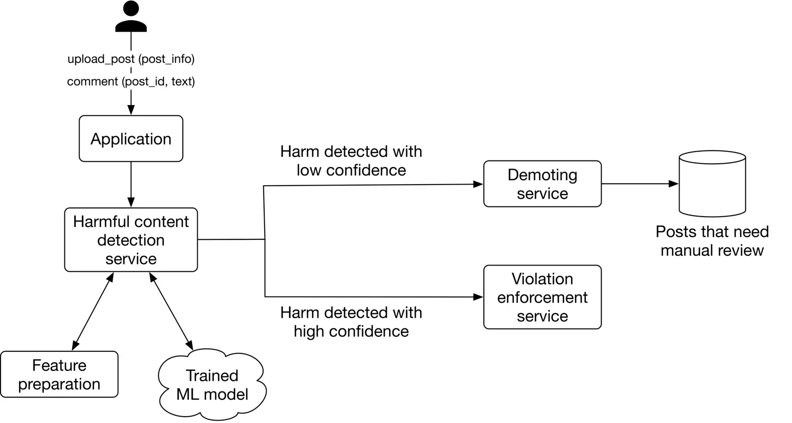

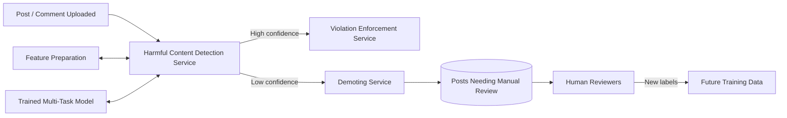

### Components
1.  **Harmful Content Detection Service:** Takes a new post, prepares features, runs the model, and predicts harm probability per class. Sensitive classes (e.g., violence) are handled immediately.
2.  **Violation Enforcement Service:** If harm is predicted with **high confidence**, takes the post down immediately and **notifies the user why** (using the per-class head that fired).
3.  **Demoting Service:** If harm is predicted with **low confidence**, temporarily demotes the post to slow its spread, then stores it for manual review.
4.  **Human Review:** Reviewers assign one of the predefined harm classes. These labels feed back into future training.

---

## 7. Interview Deep Dives (What Is Really Needed)

These are the points that separate a textbook answer from a strong one. Each ties back to a decision above.

### Scale math (say it out loud)
*   500M posts/day ÷ 86,400 s ≈ **5,800 posts/s on average**, with peaks of several times that. The model must be cheap enough per post, which is why we choose **DistilmBERT over BERT** and a single multi-task model over N separate models.
*   10K human labels/day ÷ 500M posts = **0.002%** of traffic. Human labels cannot drive training, only evaluation and the hardest cases.

### Timing problem: not every feature exists at upload time
Reactions (likes, comments, reports) arrive **after** the post is published, but the post must be judged immediately.
*   **At upload:** score using content (text, media), author and context features only.
*   **As reactions arrive:** re-score the post (batch or streaming) with comment/report features, as in the self-harm example where harm confidence rises with each supportive comment.
*   Train with the same feature availability you serve with, or the model learns from signals it will not have at prediction time (**train/serve skew**).

### Class imbalance
Harmful posts are a tiny fraction of traffic, so accuracy is meaningless (predicting "benign" always gets ~99%+). That is why we use **PR-AUC** (sensitive to the rare positive class), per-class metrics, and can add **focal loss** or class weights.

### Label noise from natural labeling
User reports are noisy (false reports, coordinated brigading, unreported harm). Mitigations:
*   Train on natural labels for volume, but **evaluate only on hand-labeled data**.
*   Weight reports by reporter reliability; require multiple reports.
*   Use reviewer decisions on the demoted queue as higher-quality labels.

### Thresholds are a product decision, per class
*   **High-confidence threshold → auto-remove.** Set high to keep false positives (wrongly removed posts) and appeals low.
*   **Low-confidence band → demote + human review.** Limits spread without final judgement.
*   Different harm classes get different thresholds. Violence/self-harm favor **recall and speed**; borderline speech favors **precision**. Tune each class from its PR curve.

### The feedback loop
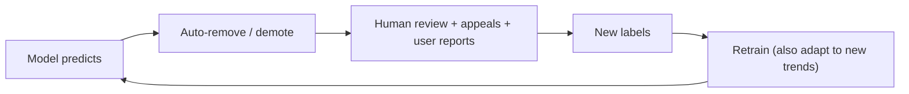
Watch for **feedback bias**: posts the model already removes never get reported, so future training data under-represents what the model catches well. Keep a small **random sample** for human review to measure true prevalence.

### Failure modes to mention
*   **Adversarial users:** obfuscated text (`v1olence`), hateful text embedded in images, edited memes. Mitigate with OCR, robust embeddings and frequent retraining.
*   **Concept drift:** new harm trends (e.g., election or health events). Mitigate with fast fine-tuning and trend-detection.
*   **Language/regional gaps:** low-resource languages get weaker embeddings and need extra labeling.
*   **Modality dominance:** one modality (image) overpowers others. Use gradient blending / focal loss.
*   **Over-removal:** hurts trust. Track **valid appeals** to catch it.

### Suggested time split for a 45-minute interview
| Part | Time | Focus |
|---|---|---|
| Clarify requirements | 5 min | Harm types, latency per class, labeling budget, explainability |
| Framing (fusion + category) | 8 min | Why early fusion, why multi-task |
| Data and features | 10 min | Per-modality features, labels |
| Model and evaluation | 10 min | Loss, offline and online metrics |
| Serving and deep dives | 12 min | Two-tier enforcement, feedback loop, failure modes |

---

## 8. Other Talking Points
*   Handle bias introduced by human labeling.
*   Adapt quickly to trending harmful classes (e.g., Covid-19, elections).
*   Use temporal information such as users' sequence of actions.
*   Select post samples for human review effectively (active learning).
*   Detect authentic vs. fake accounts.
*   Handle **borderline content** that is allowed by guidelines but close to the red line.
*   Make the system efficient enough for **on-device** deployment.
*   Replace Transformers with **linear Transformers** for a cheaper system.

---

## Source
ByteByteGo, *Machine Learning System Design Interview*, Chapter 5: Harmful Content Detection.
